# Ambiente de desktop|dde|

## Visão geral

O sistema operacional UnionTech (abreviado como "UnionTech UOS") é um sistema operacional de desktop desenvolvido na China, bonito, fácil de usar, seguro e confiável. O UnionTech UOS vem com vários aplicativos nativos, como gerenciador de arquivos, loja de aplicativos, visualizador de imagens e monitor do sistema. Ele oferece opções de entretenimento variadas e atende às necessidades do trabalho diário. Com a evolução e o aprimoramento contínuos de seus recursos, o UnionTech UOS se tornou um dos sistemas operacionais de desktop mais populares da China.

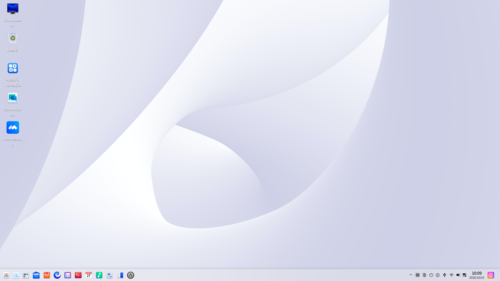

### Introdução ao sistema

Ao iniciar o sistema operacional UnionTech pela primeira vez, o aplicativo de boas-vindas é aberto automaticamente. Você pode assistir a vídeos sobre os recursos do sistema, escolher o modo da área de trabalho e o tema dos ícones e conhecer melhor o sistema.

Depois de entrar no sistema, você pode usar o ambiente de desktop UOS. Ele é composto principalmente pela área de trabalho, barra de tarefas, lançador, Central de Controle e gerenciador de janelas, que formam a base para o uso do sistema operacional.

## Área de trabalho

A área de trabalho é a tela principal exibida após o login. Nela, você pode criar arquivos e pastas, organizar arquivos, abrir o terminal, definir o papel de parede e a proteção de tela. Também é possível adicionar atalhos de aplicativos à área de trabalho usando [Enviar para a área de trabalho](#configurar-atalhos).

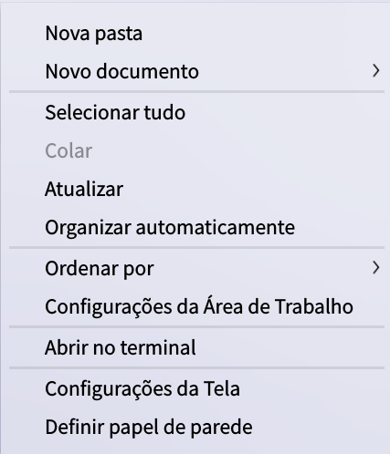

>  Observação: no touchpad, deslize quatro ou cinco dedos para baixo para mostrar a área de trabalho e, em seguida, para cima para ocultá-la. Esse gesto corresponde ao atalho **Super** + **D**.

### Criar uma pasta ou um documento

Você pode criar pastas ou documentos na área de trabalho e executar operações comuns com arquivos, assim como no gerenciador de arquivos.

- Na área de trabalho, clique com o botão direito do mouse em **Nova pasta** e digite o nome da pasta.
- Na área de trabalho, clique com o botão direito do mouse em **Novo documento**, escolha o tipo e digite o nome do documento.

Clique com o botão direito em um arquivo ou pasta na área de trabalho para abrir um menu com as seguintes funções principais:

| Função    | Descrição                           |
| ----- | ---------------------------- |
| Abrir com  | Define o aplicativo padrão do sistema ou escolhe outro aplicativo associado para abrir o arquivo. |
| Compactar/Descompactar | Compacta arquivos ou pastas ou descompacta um arquivo compactado.         |
| Recortar    | Move um arquivo ou uma pasta.                    |
| Copiar    | Copia um arquivo ou uma pasta.                    |
| Renomear   | Renomeia um arquivo ou uma pasta.                   |
| Excluir    | Exclui um arquivo ou uma pasta.                    |
| Criar link  | Cria um atalho.                    |
| Marcar  | Adiciona marcadores para organizar arquivos e pastas por etiquetas.      |
| Propriedades    | Exibe informações básicas do arquivo ou da pasta, as opções de compartilhamento e as permissões.      |

>  Observação:
> 
> - Em um computador com tela sensível ao toque, mantenha o dedo pressionado na tela por 1 segundo e solte para abrir o menu de contexto do item.
> - No touchpad, toque com dois dedos para exibir o menu de contexto.
> - Pressione **Alt** + **M** no teclado para abrir o menu de contexto.

### Definir a ordem de organização

Você pode organizar os ícones da área de trabalho conforme necessário.

1. Clique com o botão direito do mouse na área de trabalho.
2. Clique em **Organizar por** e escolha uma opção:
   - Clique em **Nome** para exibir os arquivos em ordem alfabética.
   - Clique em **Data de modificação** para exibir os arquivos pela data da última modificação.
   - Clique em **Data de criação** para exibir os arquivos pela data de criação.
   - Clique em **Tamanho** para exibir os arquivos por tamanho.
   - Clique em **Tipo** para exibir os arquivos por tipo.

>  Dica: você também pode marcar **Organizar automaticamente**. Os ícones serão organizados de cima para baixo e da esquerda para a direita, seguindo a ordem atual. Quando um ícone for removido, os seguintes avançarão automaticamente para preencher o espaço.

### Ajustar o tamanho dos ícones

1. Clique com o botão direito do mouse na área de trabalho.
2. Clique em **Tamanho dos ícones**.
3. Escolha um tamanho adequado.

>  Dica: você também pode usar **Ctrl** + / ou a roda do mouse para ajustar o tamanho dos ícones na área de trabalho e no lançador.

### Configurar a tela

No menu de contexto da área de trabalho, selecione "Configurações de tela" para abrir rapidamente as configurações de escala, resolução, brilho e outras opções na Central de Controle.

1. Clique com o botão direito do mouse na área de trabalho.
2. Clique em **Configurações de tela** para abrir as configurações de tela na Central de Controle.

>  Observação: para ver as instruções detalhadas, consulte [Configurações de tela](#tela).

### Área de transferência

A área de transferência mostra todos os textos, imagens e arquivos copiados ou recortados pelo usuário atual desde o login no sistema. Você pode copiar rapidamente qualquer item exibido. O conteúdo é apagado automaticamente ao sair da sessão ou desligar o computador.

Na área de transferência, você pode arrastar imagens e arquivos diretamente para a área de trabalho para salvá-los ou arrastar textos e caracteres para um campo editável.

1. Use o atalho **Super** + **V** para abrir a área de transferência.
2. Clique duas vezes em um item para copiá-lo rapidamente. O item será movido para o topo da lista.
3. Cole o conteúdo no local desejado.
4. Passe o ponteiro sobre um item e clique em  para excluí-lo. Clique no botão na parte superior para limpar a área de transferência.

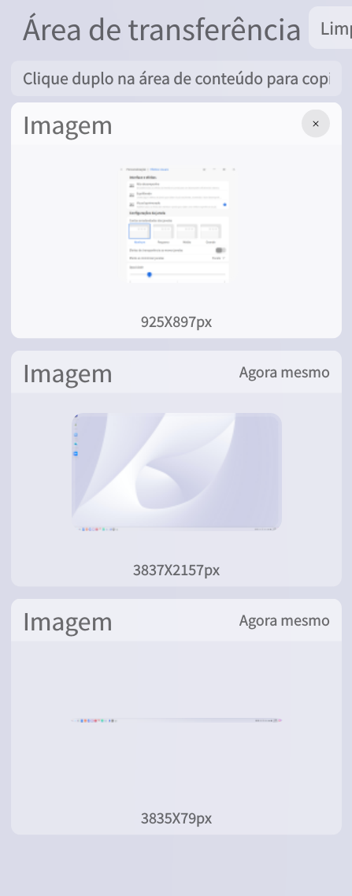

## Barra de tarefas

A barra de tarefas geralmente é a faixa na parte inferior da área de trabalho. Ela contém o lançador, ícones de aplicativos, a área da bandeja e plug-ins do sistema. Nela, você pode abrir o lançador, mostrar a área de trabalho, acessar espaços de trabalho e abrir, criar, fechar ou forçar o encerramento de aplicativos. Também pode configurar o método de entrada, ajustar o volume, conectar-se à rede, consultar o calendário e abrir a tela de desligamento.

>  Observação: também é possível configurar o modo, a posição e o estado da barra de tarefas em **Personalização > Barra de tarefas**, na Central de Controle.

### Conhecer os ícones da barra de tarefas

Os ícones da barra de tarefas incluem o ícone do lançador, os ícones de aplicativos, os ícones da bandeja e os ícones dos plug-ins do sistema.

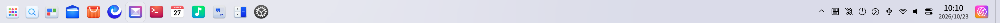

| Ícone                                                                    | Descrição                         | Ícone                                                                  | Descrição                        |
| --------------------------------------------------------------------- |:-------------------------- | ------------------------------------------------------------------- | ------------------------- |
|                             | Lançador - clique para ver todos os aplicativos instalados.        |             | Pesquisa global - pesquisa e localização de conteúdo.           |
|       | Visão multitarefa - clique para exibir os espaços de trabalho.           |                  | Gerenciador de arquivos - clique para ver arquivos e pastas no disco.   |
|                    | UOS AI Bar - acesso a recursos de IA. |              | Navegador - clique para abrir uma página da Web.             |
|                     | Loja de aplicativos - pesquisa e instalação de aplicativos.           |                   | Central de Controle - clique para abrir as configurações do sistema.          |
|                         | Música - aplicativo para reproduzir músicas.             |                      | Editor de texto - aplicativo para ver e editar arquivos de texto.    |
|                          | E-mail - aplicativo para escrever, gerenciar e enviar e-mails.     |                    | Terminal - emulador de terminal.               |
|                         | Calendário - aplicativo para consultar datas e gerenciar eventos.        | 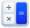                 | Calculadora - calculadora de desktop padrão, científica e para programadores. |
|                            | Central de notificações - exibe notificações do sistema e dos aplicativos.       |                                    | Teclado na tela - clique para usar o teclado virtual.          |
|  | Painel de configurações rápidas - acesso rápido às funções do sistema.           |  | Desligar - clique para abrir a tela de desligamento.            |

### Alternar o modo de exibição

A barra de tarefas oferece dois modos de exibição: Clássico e Centralizado. Cada modo apresenta tamanhos de ícone e efeitos de ativação das janelas de aplicativos diferentes.

Para alternar o modo de exibição:

1. Clique com o botão direito do mouse na barra de tarefas.
2. No submenu **Modo**, escolha um modo de exibição.

### Definir a posição da barra de tarefas

Você pode posicionar a barra de tarefas em qualquer borda da área de trabalho.

1. Clique com o botão direito do mouse na barra de tarefas.
2. No submenu **Posição**, escolha uma direção.

### Ajustar a altura da barra de tarefas

Arraste a borda da barra de tarefas para alterar sua altura.

### Desativar o ajuste livre

Ative **Desativar ajuste livre** para bloquear a altura da barra de tarefas e evitar alterações acidentais ao arrastá-la.

1. Clique com o botão direito do mouse na barra de tarefas.
2. Ative ou desative a opção **Desativar ajuste livre**.

### Mostrar ou ocultar a barra de tarefas

A barra de tarefas pode ser ocultada para ampliar ao máximo a área útil da área de trabalho.

1. Clique com o botão direito do mouse na barra de tarefas.
2. No submenu **Estado**, escolha uma opção:
   - **Sempre mostrar**: a barra de tarefas permanece visível na área de trabalho.
   - **Sempre ocultar**: a barra fica oculta e só aparece quando o ponteiro é movido para sua área.
   - **Ocultar inteligentemente**: a barra é ocultada automaticamente quando uma janela ocupa sua área.

>  Observação: em computadores com tela sensível ao toque, quando a barra de tarefas está definida como **Ocultar inteligentemente** ou **Sempre ocultar**:
> 
> - Se a barra estiver na parte inferior, deslize de baixo para cima a partir da borda da tela para mostrá-la.
> - Se estiver na parte superior, deslize de cima para baixo a partir da borda da tela.
> - Se estiver à esquerda, deslize da esquerda para a direita a partir da borda da tela.
> - Se estiver à direita, deslize da direita para a esquerda a partir da borda da tela.

### Mostrar ou ocultar plug-ins

1. Clique com o botão direito do mouse na barra de tarefas.
2. Clique em **Configurações da barra de tarefas** para abrir **Personalização > Barra de tarefas** na Central de Controle.
3. Na área de plug-ins, marque ou desmarque opções como **Lixeira**, **Monitor do sistema**, **Desligar**, **Mostrar área de trabalho**, **Teclado na tela**, **Central de notificações**, **Hora** e **Captura de tela e gravação** para definir quais serão exibidas na barra.

### Consultar notificações

Quando o sistema ou um aplicativo envia uma notificação, ela aparece na parte superior da área de trabalho. Se houver um botão, clique nele para executar a ação correspondente. Caso contrário, clique na notificação para fechá-la.

Você também pode clicar em  na barra de tarefas para abrir a Central de notificações e consultar todas as notificações.
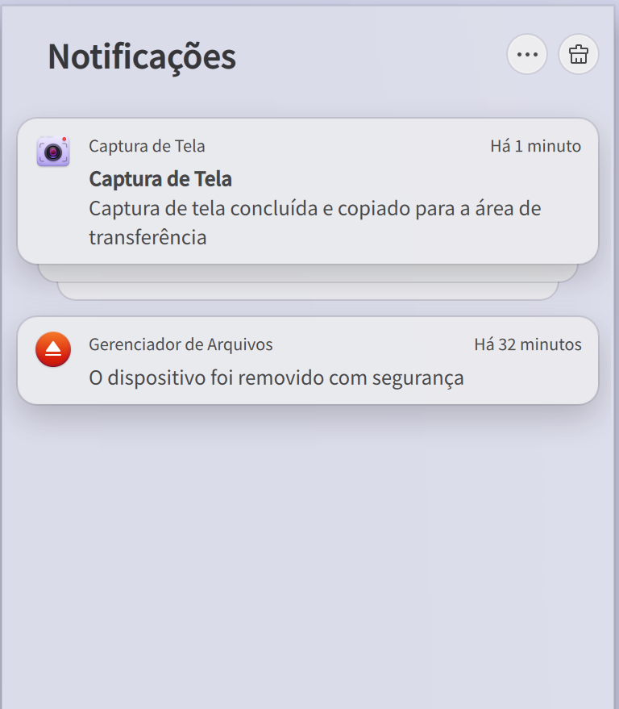
&nbsp;&nbsp;&nbsp;&nbsp;&nbsp;&nbsp;&nbsp;&nbsp;&nbsp;&nbsp;&nbsp;&nbsp;&nbsp;

>  Observação: em computadores com tela sensível ao toque, deslize da borda direita da tela para dentro por uma distância maior que a altura da barra de tarefas para abrir a Central de notificações.

### Consultar data e hora

- Passe o ponteiro sobre o relógio na barra de tarefas para consultar a data, o dia da semana e a hora atuais.
- Clique no relógio para abrir o plug-in de calendário.

### Abrir a tela de desligamento

Clique em  na barra de tarefas ou em  no modo de janela pequena do lançador para abrir a tela de desligamento.

| Função                                                                 | Descrição                                   |
| ------------------------------------------------------------------ | ------------------------------------ |
| Desligar                | Desliga o computador.                                |
| Reiniciar                    | Desliga e inicia o computador novamente.                       |
| Suspender                  | Coloca todo o sistema em estado de baixo consumo de energia.                     |
| Hibernar                        | Esta opção não é exibida sem uma partição swap. Em computadores com partição swap, a hibernação salva o estado no disco. |
| Bloquear                        | Bloqueia o computador. Use **Super** + **L** para bloqueá-lo.     |
| Trocar usuário          | Escolhe outra conta de usuário para entrar no sistema.                         |
| Sair                    | Encerra a sessão do usuário atual.                         |
| Monitor do sistema | Abre rapidamente o monitor do sistema.                           |

>  Observação: **Trocar usuário**  só é exibido quando há várias contas no sistema.

### Lixeira

Na Lixeira, você pode encontrar arquivos removidos temporariamente do computador e restaurá-los ou excluí-los de forma permanente.

#### Restaurar arquivos

Você pode restaurar arquivos removidos temporariamente pela Lixeira ou usar **Ctrl** + **Z** para restaurar o arquivo que acabou de excluir.

1. Na Lixeira, selecione o arquivo que deseja recuperar.
2. Clique com o botão direito do mouse e selecione **Restaurar**.
3. O arquivo será restaurado ao local de armazenamento original.

>  Atenção: se a pasta original tiver sido excluída, uma nova pasta será criada automaticamente durante a restauração.

#### Excluir arquivos

Você pode excluir arquivos individualmente da Lixeira.

1. Na Lixeira, selecione o arquivo que deseja excluir.
2. Clique com o botão direito do mouse e selecione **Excluir**.

#### Esvaziar a Lixeira

Na Lixeira, clique em **Esvaziar** para excluir permanentemente todo o conteúdo.

## Lançador

O lançador  permite gerenciar todos os aplicativos instalados no sistema. Use a navegação por categorias ou a pesquisa para encontrar rapidamente o aplicativo desejado.

No lançador, os aplicativos recém-instalados são identificados por um pequeno ponto azul.

>  Observação: toque no touchpad com quatro dedos para mostrar ou ocultar o lançador. Esse gesto corresponde à tecla **Super**.

### Alternar o modo

O lançador tem dois modos: tela cheia e janela pequena. Clique no ícone no canto superior direito do lançador para alternar entre eles.

Os dois modos permitem pesquisar aplicativos e configurar atalhos, entre outras operações.

O modo de janela pequena também permite abrir rapidamente o gerenciador de arquivos e a Central de Controle, além de acessar a tela de desligamento.

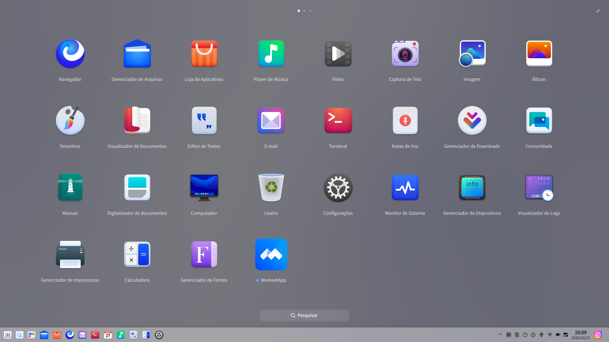

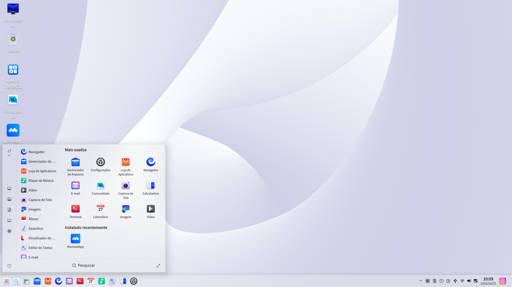

### Organizar aplicativos

No modo de janela pequena, o padrão é **Ordem livre**: os aplicativos instalados mais recentemente aparecem no topo e os demais são organizados pela frequência de uso. Você também pode escolher uma destas opções:

- **Por categoria**: organiza por tipo de aplicativo.
- **Por nome**: organiza pela inicial do nome do aplicativo.

### Encontrar aplicativos

No lançador, você pode usar a roda do mouse ou navegar pelas categorias para encontrar aplicativos.

Se souber o nome do aplicativo, digite uma palavra-chave ou suas iniciais na caixa de pesquisa para localizá-lo rapidamente.

### Configurar atalhos

Os atalhos oferecem uma maneira rápida e simples de iniciar aplicativos.

#### Criar atalhos

Envie aplicativos para a área de trabalho ou para a barra de tarefas para facilitar o acesso.

No lançador, clique com o botão direito do mouse no ícone de um aplicativo e escolha:

- **Enviar para a área de trabalho** para criar um atalho na área de trabalho.

- **Enviar para a barra de tarefas** para fixar o aplicativo na barra de tarefas.

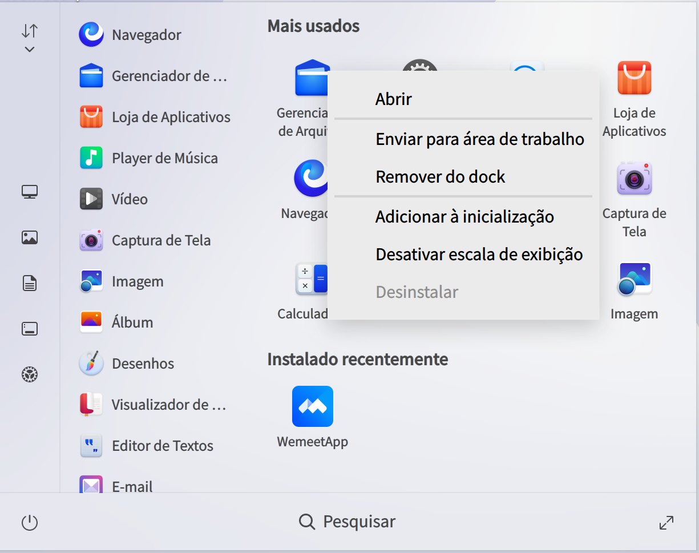

>  Observação: você também pode arrastar o ícone de um aplicativo do lançador para a barra de tarefas. Não é possível fixar o aplicativo arrastando-o enquanto ele estiver em execução. Nesse caso, clique com o botão direito do mouse no ícone do aplicativo na barra de tarefas e selecione **Manter na barra** para fixá-lo e abri-lo rapidamente da próxima vez.

#### Remover atalhos

Você pode remover atalhos de aplicativos diretamente da área de trabalho, da barra de tarefas ou do lançador.

**Remover da barra de tarefas**

- Na barra de tarefas, mantenha pressionado o botão esquerdo do mouse e arraste o ícone do aplicativo para fora da barra para remover o atalho.
- Clique com o botão direito do mouse no ícone do aplicativo na barra e selecione **Remover da barra**.

**Remover do lançador**

No lançador, clique com o botão direito do mouse no ícone de um aplicativo e escolha:

- **Remover da área de trabalho** para excluir o atalho da área de trabalho.
- **Remover da barra de tarefas** para desafixar o aplicativo da barra.

>  Observação: essas operações removem apenas os atalhos; elas não desinstalam os aplicativos.

### Instalar aplicativos

Se o aplicativo desejado não estiver no lançador, você poderá baixá-lo e instalá-lo com um clique pela loja de aplicativos.

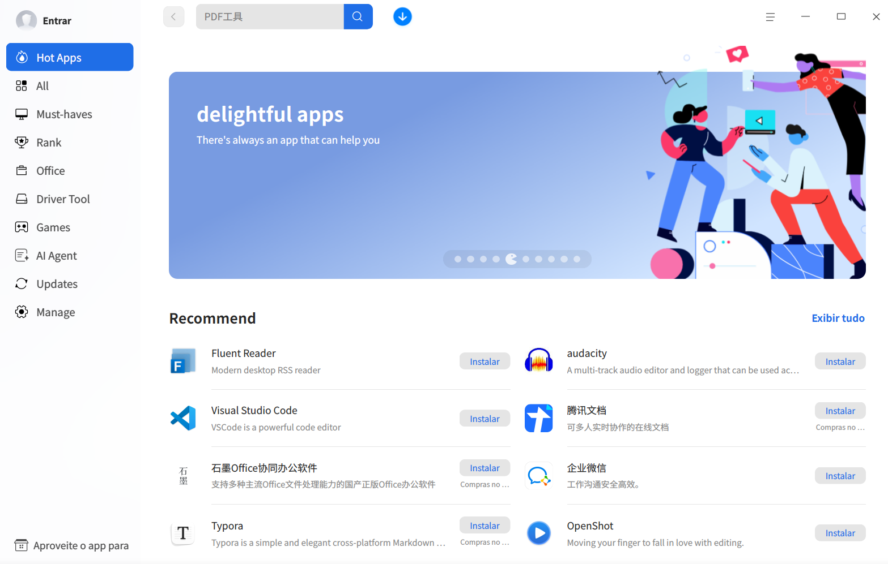

### Executar aplicativos

Para abrir um aplicativo com atalho na área de trabalho ou fixado na barra de tarefas, use uma destas opções:

- Clique duas vezes no ícone da área de trabalho ou clique nele com o botão direito e selecione **Abrir**.
- Clique no ícone do aplicativo na barra de tarefas ou clique nele com o botão direito e selecione **Abrir**.

No lançador, clique no ícone do aplicativo para abri-lo ou clique nele com o botão direito e selecione **Abrir**.

>  Dica: para aplicativos usados com frequência, clique com o botão direito do mouse no ícone no lançador e selecione **Iniciar automaticamente ao ligar**.

### Desinstalar aplicativos

Você pode desinstalar aplicativos que não usa mais para liberar espaço em disco.

1. No lançador, clique com o botão direito do mouse no ícone do aplicativo.
2. Clique em **Desinstalar**.

>  Observação: alguns aplicativos do sistema não podem ser desinstalados.

## Central de Controle

No sistema operacional UnionTech, a Central de Controle gerencia as configurações básicas do sistema, incluindo contas, rede, data e hora, personalização, tela e atualizações. Depois de entrar no ambiente de desktop, clique em  na barra de tarefas para abrir a Central de Controle.

### Página inicial

A página inicial da Central de Controle apresenta os módulos de configuração para facilitar a consulta e o acesso rápido às opções do dia a dia.

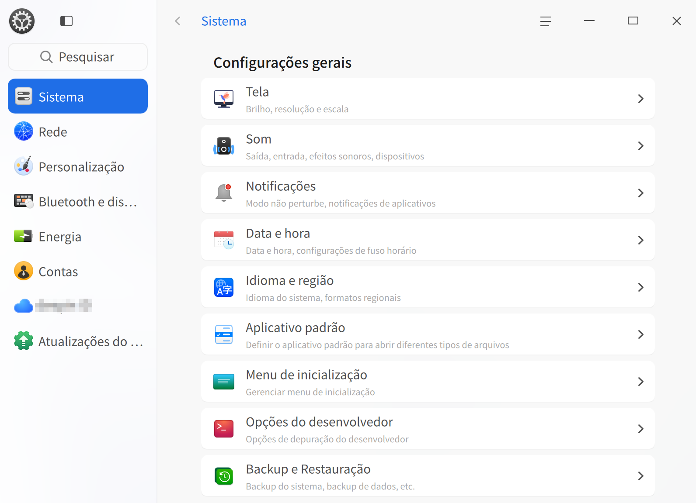

Depois de abrir um módulo de configuração, use a barra de navegação à esquerda para alternar rapidamente para outro módulo.

#### Barra de título

A barra de título contém o botão Voltar, a caixa de pesquisa, o menu principal e os botões da janela.

- Botão Voltar : clique para retornar ao nível anterior.
- Navegação estrutural: clique para retornar ao nível correspondente da página.
- Caixa de pesquisa: digite uma palavra-chave e pressione Enter para pesquisar as configurações correspondentes.
- Menu principal: clique para abri-lo. Nele, você pode definir o tema das janelas, consultar a versão ou sair da Central de Controle.

### Sistema

#### Tela

Configure o brilho, a resolução, a orientação e a escala da tela para obter a melhor exibição no computador.

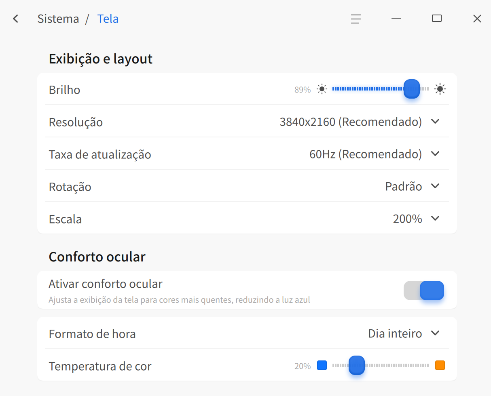

##### Configurar uma única tela

Quando há apenas uma tela, você pode ajustar o brilho, a resolução, a taxa de atualização e a orientação da tela.

**Ajustar o brilho**

O módulo de brilho é exibido somente quando o dispositivo ou a configuração oferece suporte ao ajuste de brilho. Nesse caso, siga estas etapas:

1. Na barra lateral da Central de Controle, selecione **Sistema** e clique em **Tela**.
2. Na área de brilho, arraste o controle deslizante para ajustar o brilho da tela.

**Definir a escala da tela**

Se a área de trabalho e as janelas estiverem grandes ou pequenas demais, ajuste a escala da tela para exibi-las corretamente.

1. Na barra lateral da Central de Controle, selecione **Sistema** e clique em **Tela**.
2. Clique na lista suspensa e escolha um fator de escala.
3. Saia da sessão e entre novamente para aplicar a escala da tela.

>  Observação:
> 
> - Quando uma tela de alta densidade é detectada, o fator de escala é ajustado automaticamente.
> - Alguns aplicativos não são compatíveis com a escala da tela. Para obter uma exibição melhor, clique com o botão direito do mouse no aplicativo no lançador e selecione **Desativar escala da tela**.

**Alterar a resolução**

1. Na barra lateral da Central de Controle, selecione **Sistema** e clique em **Tela**.
2. Na lista suspensa de resolução, escolha a resolução adequada.
3. Clique em **Salvar**.

**Configurar a exibição da área de trabalho**

Quando a placa de vídeo é compatível com esse recurso e a resolução definida não é a recomendada, siga estas etapas:

1. Na barra lateral da Central de Controle, selecione **Sistema** e clique em **Tela**.
2. Na lista suspensa da área de exibição da área de trabalho, escolha um efeito adequado.

**Definir a taxa de atualização da tela**

1. Na barra lateral da Central de Controle, selecione **Sistema** e clique em **Tela**.
2. Na lista suspensa de taxa de atualização, escolha uma opção adequada.
3. Clique em **Salvar**.

**Alterar a orientação da tela**

1. Na barra lateral da Central de Controle, selecione **Sistema** e clique em **Tela**.
2. Na lista suspensa de orientação, escolha uma opção adequada.
3. Clique em **Salvar**.

**Configurar o modo de proteção ocular**

O módulo de proteção ocular é exibido somente quando o dispositivo ou a configuração oferece suporte ao recurso. Nesse caso, siga estas etapas:

1. Na barra lateral da Central de Controle, selecione **Sistema** e clique em **Tela**.
2. Na área **Modo de proteção ocular**, você pode:
   - Ativar **Modo de proteção ocular**.
   - Definir quando o modo será ativado. Na área de horário, escolha **O dia todo**, **Do pôr do sol ao nascer do sol** ou **Personalizado**. O padrão é **O dia todo**.
   - Definir a temperatura de cor da proteção ocular arrastando o controle deslizante correspondente.

##### Configurar várias telas

Com várias telas, você pode ampliar a área de exibição. Conecte o computador a outro monitor ou projetor usando cabos VGA, HDMI, DP ou similares para exibir o conteúdo em várias telas ao mesmo tempo. O módulo de configuração de várias telas aparece quando outro dispositivo de exibição é conectado.

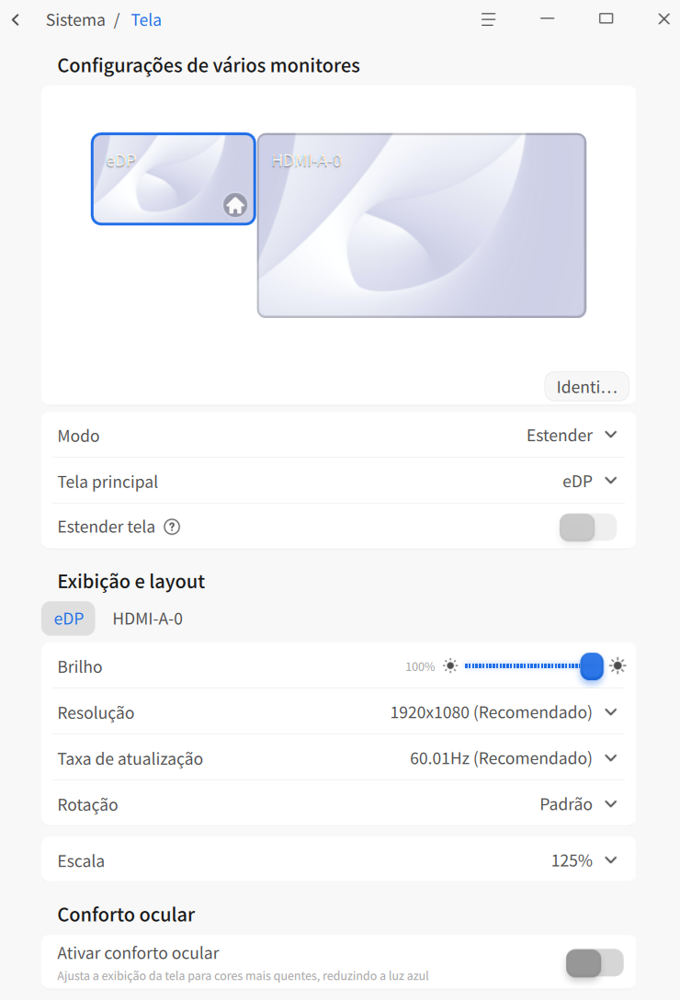

1. Na barra lateral da Central de Controle, selecione **Sistema** e clique em **Tela**.
2. Na área de configuração de várias telas, escolha um modo de exibição na lista **Modo**.
   - **Espelhar**: duplica o conteúdo da tela principal nas outras telas.
   - **Estender**: amplia a área de trabalho da tela principal para as outras telas.
   - **Exibir somente em xxx**: mostra o conteúdo apenas em uma tela.

Nos modos Espelhar ou Estender, clique em **Identificar** para exibir o nome de cada tela no centro dela.

No modo Estender, a janela de agrupamento reúne as janelas de configuração das outras telas no centro da tela selecionada.

- No agrupamento da tela principal, a janela de configuração da tela principal fica atrás das janelas das telas secundárias.
- No agrupamento de uma tela secundária, a janela de configuração dessa tela fica em primeiro plano e a da tela principal fica atrás.

>  Observação: no modo Estender, em **Personalização > Barra de tarefas**, na área de configuração de várias telas, há duas opções mutuamente exclusivas para a barra: **Exibir somente na tela principal** e **Exibir na tela onde o ponteiro está**.

Em um ambiente com várias telas, pressione **Super** + **P** para abrir o OSD dos modos de exibição.
Siga estas etapas:

1. Mantenha **Super** pressionada e pressione **P** ou clique com o mouse para escolher um modo.
2. Solte as teclas para confirmar a seleção e aplicar o modo.

>  Observação: no modo de várias telas, as telas secundárias também permitem exibir ícones da área de trabalho e usar o menu de contexto.

As configurações de brilho, temperatura de cor, escala, resolução, taxa de atualização e orientação em várias telas são iguais às de uma única tela. Para ver as instruções, consulte [Configurar uma única tela](#configurar-uma-única-tela).

**Combinar telas**

No modo Estender, quando vários monitores estão organizados em um retângulo, você pode ativar a combinação de telas. Esse recurso reúne os monitores físicos em uma única área lógica contínua para exibir uma só área de trabalho em várias telas.

1. Na área de configuração de várias telas, selecione o modo **Estender**.
2. Ajuste o layout para que as telas formem um retângulo.
3. Ative **Combinar telas**.

>  Observação: no modo Combinar telas, o ajuste de brilho continua disponível, mas as configurações de arranjo, resolução, taxa de atualização, orientação e escala ficam desativadas. O sistema sai automaticamente desse modo quando um monitor é conectado ou desconectado ou quando o modo de várias telas é alterado.

#### Som

Configure o áudio dos dispositivos de entrada e saída, como alto-falantes e microfones, para ouvir com mais conforto e gravar com mais clareza.

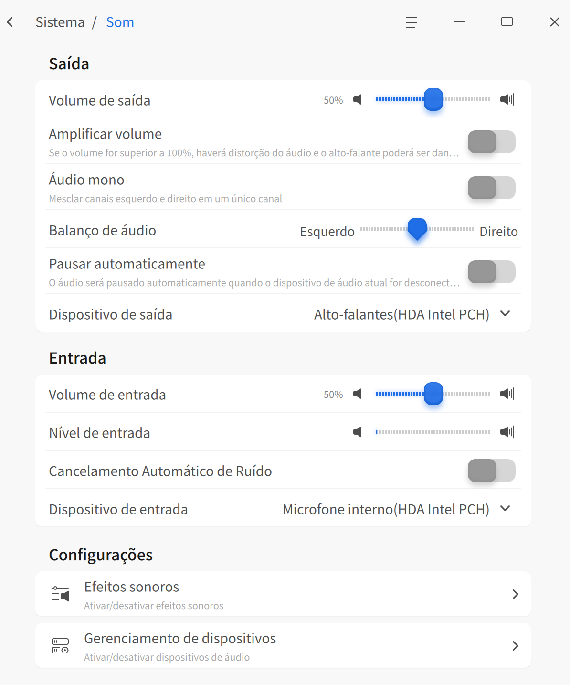

##### Configurações de saída

1. Na barra lateral da Central de Controle, selecione **Sistema** e clique em **Som**.
2. Na tela de configuração dos dispositivos de áudio, ajuste a saída:
   - Arraste os controles deslizantes para ajustar o volume de saída e o balanço entre os canais esquerdo e direito.
   - Ative **Amplificação de volume** para alterar o intervalo ajustável de 0–100% para 0–150%.
   - Ative **Áudio mono** para combinar os canais esquerdo e direito em um só canal.
   - Ative **Gerenciamento de conexão** para pausar automaticamente a saída de áudio quando um periférico for desconectado.
   - Na lista ao lado do dispositivo de saída, escolha o tipo de dispositivo.

##### Configurações de entrada

1. Na barra lateral da Central de Controle, selecione **Sistema** e clique em **Som**.
2. Na tela de configuração dos dispositivos de áudio, ajuste a entrada:
   - Arraste o controle deslizante para ajustar o volume de entrada.
   - Ative a opção correspondente para configurar também **Supressão de ruído**.
   - Na lista ao lado do dispositivo de entrada, escolha o tipo de dispositivo.

>  Dica: em geral, aumente o volume de entrada o suficiente para captar a fonte de áudio, mas evite deixá-lo muito alto para não distorcer o som. Fale em volume normal perto do dispositivo de entrada, como um microfone, e observe o nível de entrada. Se ele variar de forma perceptível, o volume está adequado.

##### Efeitos sonoros do sistema

1. Na barra lateral da Central de Controle, selecione **Sistema** e clique em **Som**.
2. Clique em **Efeitos sonoros do sistema** e marque as opções para ativar sons para determinados eventos.

>  Dica: clique no botão de reprodução para ouvir um efeito sonoro.

##### Gerenciamento de dispositivos

1. Na barra lateral da Central de Controle, selecione **Sistema** e clique em **Som**.
2. Clique em **Gerenciamento de dispositivos** para ativar ou desativar dispositivos de entrada e saída.

#### Notificações

Configure o modo Não perturbe e escolha se as notificações de determinados aplicativos serão exibidas.

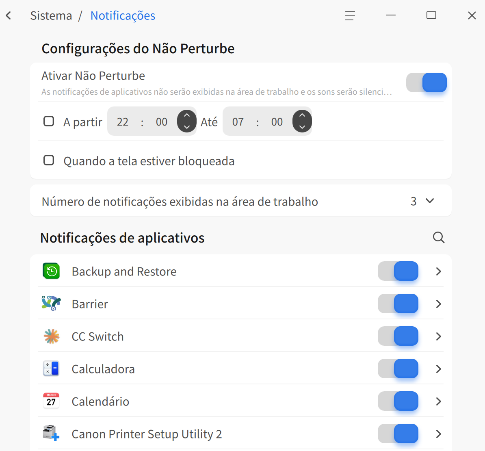

##### Configurar notificações do sistema

Configure o modo Não perturbe para as notificações do sistema.

1. Na barra lateral da Central de Controle, selecione **Sistema**.

2. Clique em **Notificações** para abrir as configurações de notificações do sistema.
   
   - Ative ou desative o modo Não perturbe.
     Quando ele estiver ativado, você poderá definir os horários de início e término e escolher se as notificações serão exibidas **quando a tela estiver bloqueada**. O modo silencia todas as notificações, mas você ainda pode consultá-las na Central de notificações.

##### Configurar notificações de aplicativos

Personalize a exibição das notificações de cada aplicativo.

1. Na barra lateral da Central de Controle, selecione **Sistema** e clique em **Notificações de aplicativos**.
2. Selecione um aplicativo na área de notificações e ative-o. Você poderá escolher:
   - Ativar ou desativar o som das notificações.
   - Exibir as notificações na Central de notificações ou na área de trabalho.
   - Exibir ou não uma prévia da mensagem.

#### Data e hora

Selecione o fuso horário correto para exibir a data e a hora locais no computador. Você também pode alterá-las manualmente.

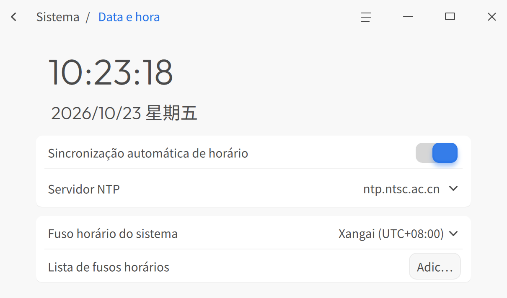

##### Alterar a data e a hora

Por padrão, o sistema sincroniza automaticamente a data e a hora locais do fuso horário pela rede. Você também pode desativar a sincronização automática e alterá-las manualmente.

1. Na barra lateral da Central de Controle, selecione **Sistema** e clique em **Data e hora**.
2. Desative **Sincronização automática**.
3. Defina manualmente a data e a hora corretas.
4. Clique em **OK**.

>  Observação: você também pode ativar **Sincronização automática** e definir os parâmetros de sincronização do servidor. Adicione endereços de servidores de fuso horário para sincronizar automaticamente.

##### Alterar o fuso horário

O fuso horário do sistema é escolhido durante a instalação. Para alterá-lo, siga estas etapas:

1. Na barra lateral da Central de Controle, selecione **Sistema** e clique em **Data e hora**.
2. Clique em **Alterar fuso horário do sistema** e pesquise ou selecione um fuso horário na lista suspensa.

##### Adicionar um fuso horário

Você pode usar vários fusos horários ao mesmo tempo para consultar a hora em outros locais.

1. Na barra lateral da Central de Controle, selecione **Sistema** e clique em **Data e hora**.
2. Na lista de fusos horários, clique em **Adicionar** e pesquise o fuso horário desejado.
3. Clique em **Adicionar**.

##### Remover um fuso horário

1. Na barra lateral da Central de Controle, selecione **Sistema** e clique em **Data e hora**.
2. Clique em **Remover** ao lado do fuso horário que deseja excluir da lista.

#### Idioma e região

O idioma padrão do sistema é o selecionado durante a instalação, mas pode ser alterado a qualquer momento. Adicione vários idiomas à lista para alternar entre eles.

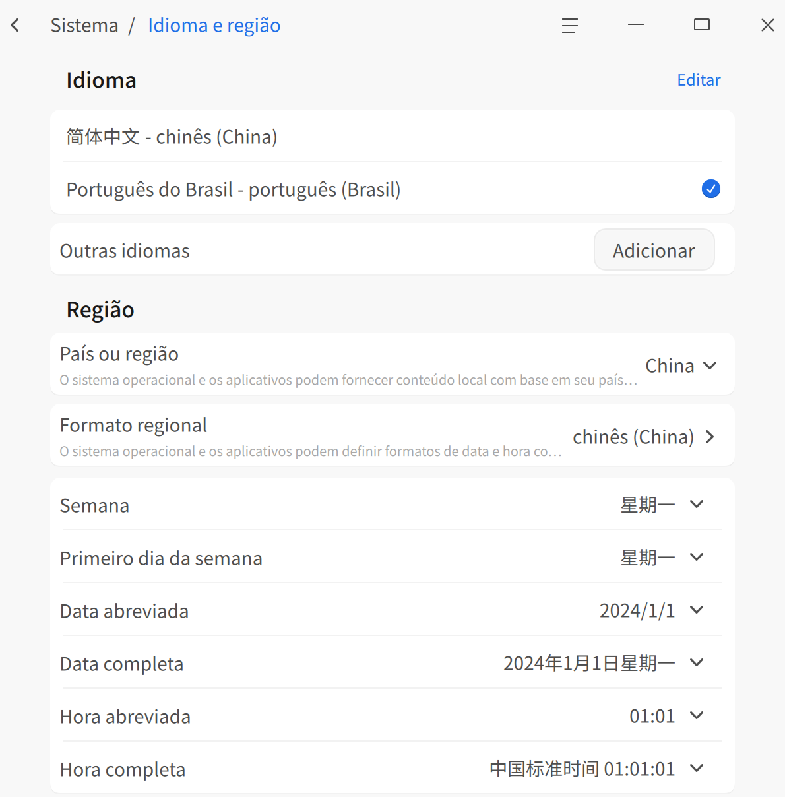

##### Adicionar um idioma do sistema

Você pode adicionar vários idiomas à lista para alternar o idioma do sistema.

1. Na barra lateral da Central de Controle, selecione **Sistema**.
2. Clique em **Idioma e região** para abrir as configurações de idioma do sistema.
3. Clique em **Adicionar** para abrir a lista de idiomas.
4. Selecione um idioma. Ele será adicionado automaticamente à lista.

##### Definir o idioma do sistema

1. Na barra lateral da Central de Controle, selecione **Sistema**.
2. Clique em **Idioma e região** para abrir as configurações de idioma do sistema.
3. Selecione o idioma desejado. O sistema começará a instalar o pacote de idiomas automaticamente.
4. Depois que a instalação terminar, saia da sessão e entre novamente para aplicar a configuração.

>  Atenção: alterar o idioma do sistema também pode alterar o layout do teclado. Ao entrar novamente, use o layout correto para digitar a senha.

##### Região

1. Na barra lateral da Central de Controle, selecione **Sistema**.
2. Clique em **Idioma e região** para abrir as configurações regionais.
3. Depois da configuração inicial de **Região**, você poderá alterá-la. Com base na região selecionada, o sistema recomendará métodos de entrada, layouts de teclado e formatos. Use a lista suspensa para escolher uma região.
4. As opções de **Região e formato** podem ser alteradas após a configuração inicial. A região define formatos convencionais de data, moeda e números. Depois de escolher uma região e um formato, clique em **Salvar** para aplicar a alteração.
5. Em **Formato**, defina a exibição da hora na barra de tarefas escolhendo os formatos de hora e data.

#### Aplicativos padrão

Quando vários aplicativos com funções semelhantes estiverem instalados, você poderá definir qual deles será usado por padrão para abrir cada tipo de arquivo pelo menu de contexto ou pela Central de Controle.

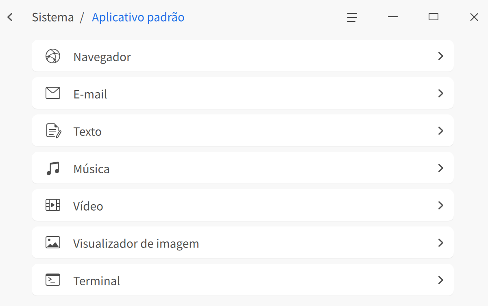

##### Definir um aplicativo padrão

1. Clique com o botão direito do mouse em um arquivo e selecione **Abrir com** > **Escolher aplicativo padrão**.
2. Selecione um aplicativo. **Definir como padrão** será marcado automaticamente. Clique em **OK**.
3. O aplicativo será adicionado automaticamente à lista de aplicativos padrão da Central de Controle.

##### Alterar o aplicativo padrão

1. Na barra lateral da Central de Controle, selecione **Sistema** e clique em **Aplicativos padrão**.
2. Selecione um tipo de arquivo para abrir a lista de aplicativos padrão.
3. Escolha outro aplicativo na lista.

##### Adicionar um aplicativo padrão

1. Na barra lateral da Central de Controle, selecione **Sistema** e clique em **Aplicativos padrão**.
2. Selecione um tipo de arquivo para abrir a lista de aplicativos padrão.
3. Clique em **Adicionar aplicativo padrão** ou **Adicionar** abaixo da lista e selecione um arquivo desktop (geralmente em `/usr/share/applications`) ou um arquivo binário específico.
4. Adicione o programa à lista e marque-o para defini-lo como padrão.

##### Remover um aplicativo padrão

Na lista de aplicativos padrão, você só pode remover os aplicativos que adicionou. Os aplicativos instalados com o sistema só podem ser removidos por desinstalação; depois disso, eles serão excluídos automaticamente da lista.

Para remover um aplicativo padrão que você adicionou:

1. Na barra lateral da Central de Controle, selecione **Sistema** e clique em **Aplicativos padrão**.
2. Selecione um tipo de arquivo para abrir a lista de aplicativos padrão.
3. Clique em  ao lado do programa para removê-lo.

#### Menu de inicialização

O módulo Menu de inicialização gerencia as configurações de inicialização do computador.

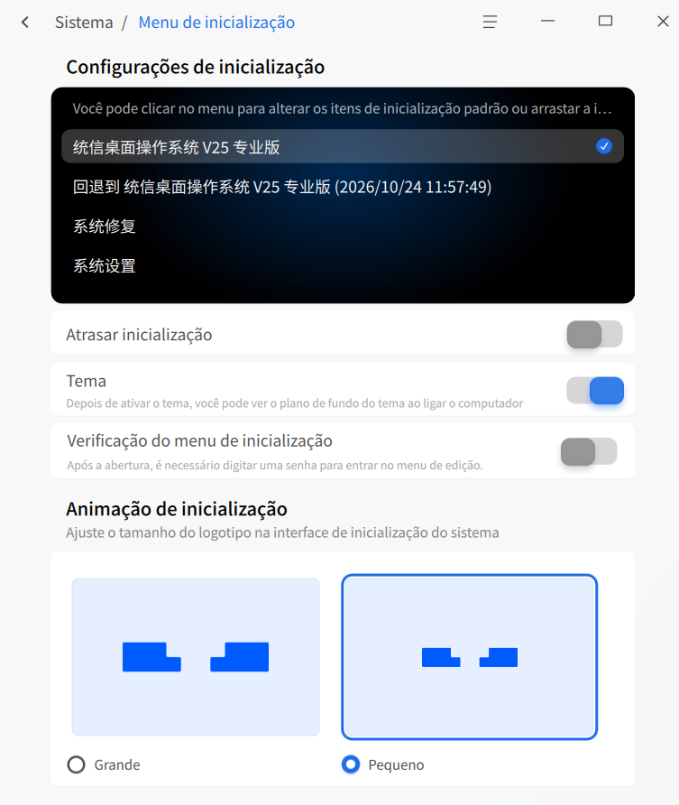

##### Configurar o menu de inicialização

O menu de inicialização permite escolher um sistema operacional ao ligar o computador. Depois que você seleciona um sistema, o computador inicia esse sistema operacional.

>  Observação: sistemas com arquitetura ARM oferecem suporte apenas à verificação do GRUB. Sistemas com arquitetura MIPS ainda não oferecem suporte à verificação do GRUB nem à alteração da imagem de fundo do menu de inicialização.

**Alterar o item de inicialização padrão**

1. Na barra lateral da Central de Controle, selecione **Sistema**.
2. Clique em **Menu de inicialização**.
3. Selecione um item do menu. Na janela de autenticação, digite a senha para autorizá-lo e defini-lo como padrão.

**Definir o atraso de inicialização**

Quando **Atraso de inicialização** está ativado, o menu aguarda 5 segundos para que você escolha outro sistema operacional.
Quando está desativado, o menu aguarda 1 segundo.

**Tema**

1. Na barra lateral da Central de Controle, selecione **Sistema**.

2. Clique em **Menu de inicialização**.

3. Ative o tema para exibir a imagem de fundo durante a inicialização.

>  Dica: você também pode arrastar uma imagem para a janela de pré-visualização para alterar o fundo do menu de inicialização.

##### Animação de inicialização

1. Na barra lateral da Central de Controle, selecione **Sistema**.
2. Clique em **Menu de inicialização**.
3. Escolha o tamanho grande ou pequeno da animação do logotipo na tela de inicialização.

#### Opções do desenvolvedor

Ative aqui o modo de desenvolvedor. Para instalar e executar aplicativos não assinados, configure essa opção na Central de Segurança.

##### Modo de desenvolvedor

No modo de desenvolvedor, você pode usar privilégios de root e executar operações com `sudo`. Esse modo fica desativado por padrão.

>  Atenção: o uso do modo de desenvolvedor pode envolver riscos e invalidar a garantia oficial. Proceda com cautela.

Na barra lateral da Central de Controle, selecione **Sistema** e depois **Opções do desenvolvedor**. Clique em **Entrar no modo de desenvolvedor** e insira suas credenciais na janela de autenticação. Após a autenticação, o modo será ativado.

>  Atenção: não é possível sair nem reverter o modo de desenvolvedor depois de ativá-lo. Todas as contas do sistema terão privilégios de root.

##### Opções de depuração

Nas opções de depuração do desenvolvedor, você pode alterar o **Nível de registro do sistema**.

Na barra lateral da Central de Controle, selecione **Sistema** e depois **Opções do desenvolvedor**. Em **Opções de desenvolvimento e depuração**, altere **Nível de registro do sistema** para **Depuração** para obter registros mais detalhados. Essa opção fica desativada por padrão.

Nessa área, você também pode ativar ou desativar a **Proteção somente leitura do sistema**. Ao desativá-la, os diretórios do sistema são desbloqueados, o que pode danificar o sistema. Proceda com cautela.

#### Gerenciamento de domínio

1. Na barra lateral da Central de Controle, selecione **Sistema**.
2. Clique em **Gerenciamento de domínio**.
3. Ative **Gerenciamento de domínio** e defina o **Endereço do domínio** e a **Porta**.
4. Clique em **OK**.

>  Observação: o gerenciamento de domínio está disponível em sistemas com arquitetura AMD e ARM.

#### Backup e restauração

Para evitar perda ou danos aos dados causados por defeitos de software, falhas de hardware ou erros de operação, faça backup e restaure os dados de aplicativos ou do sistema para manter o funcionamento normal do sistema.

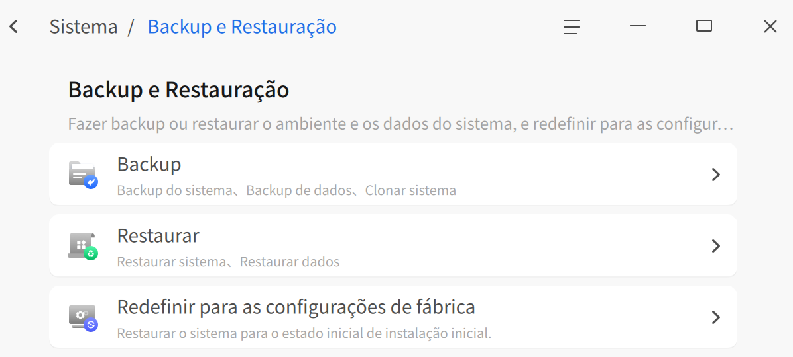

#### Sobre este computador

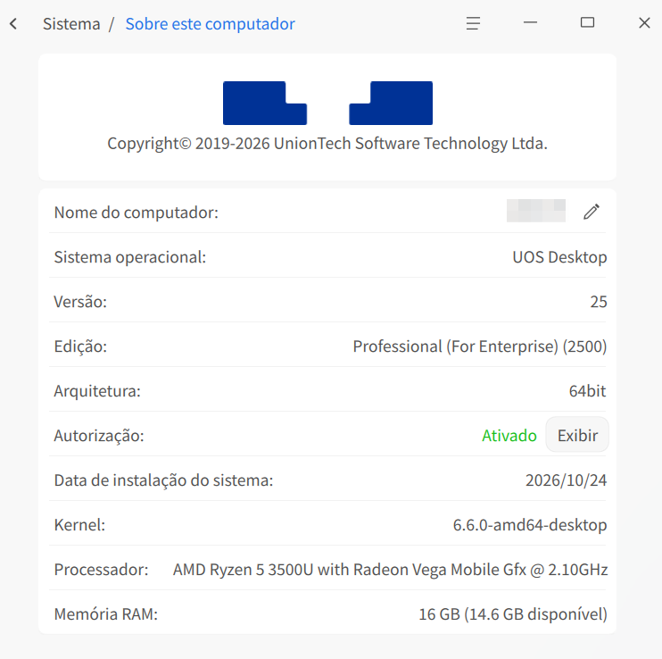

1. Na barra lateral da Central de Controle, selecione **Sistema**.

2. Em **Sobre este computador**, você pode:
   
   - Clicar em  para alterar o nome do computador.
   - Consultar a versão atual do sistema, a licença da versão, a data de instalação e as informações de hardware.

##### Gerenciamento de licença

Clique em **Ativar** para abrir a página de ativação.

Há dois **métodos de ativação**: online (ativação do período de avaliação, por número de série ou por arquivo de ativação) e offline.

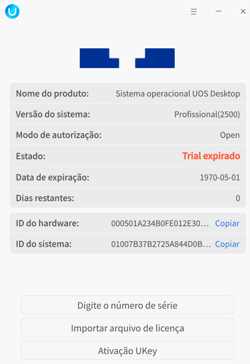

**Ativação online**

1. Ativar o período de avaliação
   - Clique em **Ativar período de avaliação** para abrir a tela de ativação.
   - Clique em **Ativar agora**. Na confirmação exibida, clique em **OK**. A tela informará que o período de avaliação foi ativado.
   - Depois da ativação, você poderá consultar o estado da ativação e a data de término do período de avaliação.
2. Ativar com um número de série
   - Clique em **Inserir número de série**, digite ou cole o número correto e clique em **Ativar agora**.

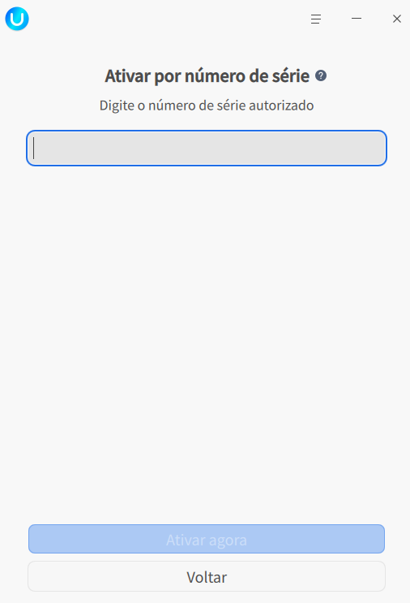
3. Ativar com um arquivo de ativação

- Clique em **Importar arquivo de ativação**. No gerenciador de arquivos, selecione um arquivo de ativação no formato `.key`.

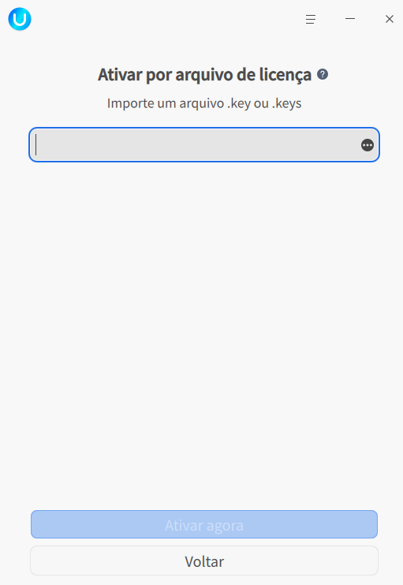

- Selecione o arquivo correto e clique em **Ativar agora**.

- Na janela de confirmação, clique em **OK**. A tela informará que a ativação foi concluída.

**Ativação offline**

- Use a ativação offline quando houver um problema de conexão de rede.
- Se o sistema detectar um problema de rede ao ativar com um número de série ou importar um arquivo de licença, a tela de ativação offline será aberta.

- Use o celular para ler o código QR. A tela de ativação será aberta no celular e exibirá o ID do computador e o número de série.

- Digite manualmente no computador o código de ativação offline exibido no celular.

- Clique em **Ativar offline** para abrir a tela de confirmação da ativação.

**Ativação concluída**

- Depois que o sistema for ativado, o ícone de gerenciamento de licença desaparecerá da bandeja no canto inferior direito. Para consultar as informações da licença, clique em **Consultar** em **Central de Controle > Informações do sistema > Sobre este computador**.

- A tela de ativação concluída mostra o nome do produto, a versão e o estado da ativação. Clique em **Ver detalhes** para consultar mais informações.
  
  As principais informações são:
   • Nome do produto: nome do sistema operacional.  
  • Versão: versão do sistema operacional.  
  • Estado da ativação: por exemplo, não ativado, expirado e não ativado ou ativado.  
  • Estado da licença: por exemplo, período de avaliação, sem licença, expirada ou licenciada.  
  • Método de ativação: método usado para ativar o sistema.  
  • Data de expiração: a partir de 10 dias antes do vencimento, uma notificação de expiração da licença será exibida sempre que o sistema for iniciado.

**Alterar o número de série**

- Depois de ativar o sistema, talvez seja necessário alterar o número de série.
- A alteração só é possível nas seguintes condições:
  - O estado da licença deve ser **Ativado**.
  - O modo de licença deve ser **OPEN**.
- Para alterar o número de série:
   1. Na tela de detalhes da ativação, clique em **Alterar número de série**.
   2. Na mensagem de confirmação, clique em **Alterar**.
   3. Na tela de ativação por número de série, digite o novo número.
   4. Clique em **Ativar agora** para concluir a alteração.

**Falha na ativação**

- Se o arquivo de ativação já tiver sido usado ou estiver inválido, a tela informará que a ativação falhou.

**Configurar o servidor de ativação**

- Se o servidor de ativação atual apresentar um problema ou falhar, abra as configurações no menu principal da tela de gerenciamento de licença para definir outro servidor.

#### Avisos de software de código aberto

1. Na barra lateral da Central de Controle, selecione **Sistema**.
2. Em **Avisos de software de código aberto**, consulte os avisos correspondentes.

#### Contrato de licença de usuário final

1. Na barra lateral da Central de Controle, selecione **Sistema**.
2. Em **Contrato de licença de usuário final**, consulte o contrato.

#### Política de privacidade

1. Na barra lateral da Central de Controle, selecione **Sistema**.
2. Em **Política de privacidade**, consulte a política.

### Rede

Depois de entrar no sistema, conecte-se à rede para receber e-mails, ler notícias, baixar arquivos, conversar e fazer compras online.

>  Dica: clique no painel de configurações rápidas da barra de tarefas para configurar e consultar o estado atual da rede.

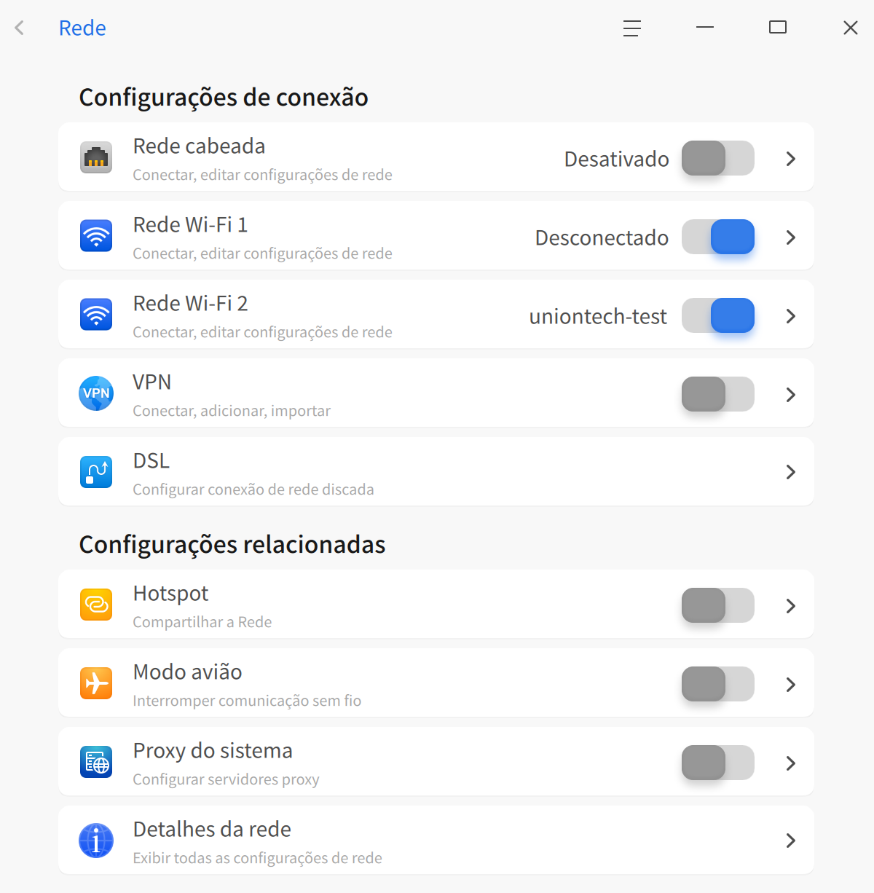

#### Rede com fio

Uma conexão com fio é segura, rápida e estável, e é a forma mais comum de conexão de rede. Depois de configurar o roteador, conecte uma extremidade do cabo de rede ao computador e a outra ao roteador.

1. Conecte o cabo de rede à porta de rede do computador.
2. Conecte a outra extremidade ao roteador ou à tomada de rede.
3. Na barra lateral da Central de Controle, selecione **Rede**.
4. Clique em **Rede com fio**.
5. Ative **Adaptador de rede com fio** para habilitar a conexão.
6. Quando a conexão for estabelecida, uma notificação informará que a rede com fio está conectada.

Você também pode editar ou criar uma configuração de rede com fio nessa tela.

#### Rede sem fio

A rede sem fio dispensa cabos, oferece mais flexibilidade de acesso e permite conectar mais dispositivos.

##### Conectar-se a uma rede sem fio

1. Na barra lateral da Central de Controle, selecione **Rede**.
2. Clique em **Rede sem fio**.
3. Ative **Adaptador de rede sem fio** para habilitar a conexão.
4. O computador pesquisará e exibirá automaticamente as redes sem fio próximas.
5. Selecione a rede desejada.
   - Se a rede for aberta, a conexão será automática.
   - Se for criptografada, digite a senha quando solicitado e clique em **Conectar**.

##### Conectar-se a uma rede oculta

Para impedir que outras pessoas encontrem sua rede sem fio e tentem descobrir a senha, você pode ocultá-la nas configurações do roteador. Depois, será necessário conectar-se manualmente à rede oculta.

1. Na barra lateral da Central de Controle, selecione **Rede**.
2. Clique em **Rede sem fio**.
3. Clique em **Conectar-se a uma rede oculta**.
4. Digite o nome da rede (SSID) e os outros dados obrigatórios.
5. Clique em **Salvar**.

#### Ponto de acesso pessoal

O ponto de acesso pessoal transforma a conexão do computador em uma rede sem fio à qual outros dispositivos próximos podem se conectar. Para ativá-lo, o computador precisa ter um adaptador de rede sem fio compatível com pontos de acesso.

1. Na barra lateral da Central de Controle, selecione **Rede**.
2. Clique em **Ponto de acesso pessoal**.
3. Ative **Ponto de acesso** e configure as informações da rede.
4. Clique em **Salvar**.

#### Modo avião

O modo avião desativa a rede sem fio, o ponto de acesso pessoal e o Bluetooth. Além da Central de Controle, você pode ativá-lo ou desativá-lo pelo painel de configurações rápidas da barra de tarefas.

1. Na barra lateral da Central de Controle, selecione **Rede**.
2. Clique em **Modo avião**.
3. Ative a opção para ligar o modo avião.

>  Atenção: se o computador não tiver um adaptador de rede sem fio nem um módulo Bluetooth, a interface do modo avião não será exibida.

#### Rede discada

DSL é uma forma de conexão à Internet por meio da linha telefônica local. Configure o modem e conecte a porta de rede dele à porta de rede do computador com um cabo. Em seguida, crie uma conexão de banda larga, informe o nome de usuário e a senha fornecidos pela operadora e conecte-se à Internet.

##### Criar uma conexão discada

1. Na barra lateral da Central de Controle, selecione **Rede**.
2. Clique em **DSL** e depois em **Criar conexão PPPoE**.
3. Digite o nome da conexão de banda larga, a conta e a senha.
4. Clique em **Salvar**. O sistema criará a conexão e tentará se conectar automaticamente.

#### VPN

VPN é uma rede privada virtual. Sua principal função é criar uma rede privada em uma rede pública para permitir comunicações criptografadas. Seja em uma viagem de trabalho ou trabalhando em casa, você pode acessar os recursos da intranet da empresa por VPN sempre que tiver acesso à Internet. Também é possível usar uma VPN para acelerar o acesso a sites de outros países.

1. Na barra lateral da Central de Controle, selecione **Rede**.
2. Clique em **VPN** e selecione **Adicionar VPN** ou **Importar VPN**.
3. Selecione o tipo de protocolo VPN e informe o nome, o gateway, o nome de usuário, a senha e outros dados. (Ao importar uma VPN, os dados são preenchidos automaticamente.)
4. Clique em **Salvar**. O sistema tentará se conectar à VPN automaticamente.
5. Você pode exportar a configuração da VPN para uso posterior ou compartilhá-la com outros usuários.

>  Observação: ative **Usar somente para recursos nesta rede** para não definir a VPN como rota padrão e usá-la apenas com recursos de rede específicos.

#### Proxy do sistema

1. Na barra lateral da Central de Controle, selecione **Rede**.
2. Clique em **Proxy do sistema**.
3. Ative o proxy do sistema e selecione **Manual** ou **Automático** na lista ao lado do tipo de proxy.
   - Selecione **Manual** para configurar o endereço, a porta e outras informações do servidor proxy.
   - Selecione **Automático** e informe uma URL para que o sistema configure o servidor proxy automaticamente.
4. Clique em **Salvar**.

#### Detalhes da rede

Na tela de detalhes da rede, você pode consultar o endereço MAC, o endereço IP, o gateway e outras informações de rede.

1. Na barra lateral da Central de Controle, selecione **Rede**.
2. Clique em **Detalhes da rede**.
3. Consulte as informações da rede com ou sem fio atual.

### Personalização

No módulo Personalização da Central de Controle, você pode alterar a aparência da área de trabalho e das janelas, incluindo o tema do sistema, a cor de destaque, as fontes, os efeitos das janelas e a opacidade. Também é possível configurar temas de ícones e do cursor e as fontes.

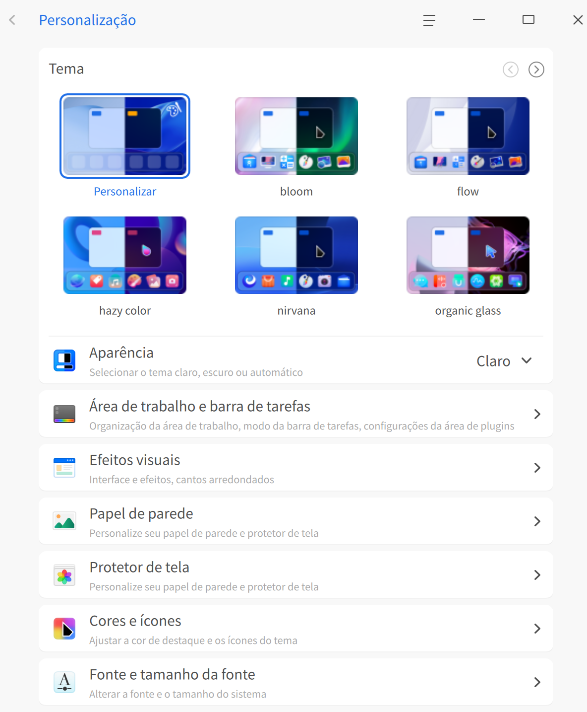

#### Definir o tema das janelas

1. Na barra lateral da Central de Controle, selecione **Personalização**.
2. Clique em **Tema** e escolha um tema do sistema.
3. O tema selecionado será aplicado ao sistema.

#### Aparência

Em Aparência, você pode escolher o modo claro ou escuro do tema.

1. Na barra lateral da Central de Controle, selecione **Personalização**.
2. Clique em **Aparência** e escolha **Claro**, **Escuro** ou **Automático**. No modo automático, a aparência clara ou escura muda conforme os horários do nascer e do pôr do sol.

>  Observação: no modo Automático, o tema das janelas muda de acordo com os horários do nascer e do pôr do sol no fuso horário atual. O tema fica claro depois do nascer do sol e escuro depois do pôr do sol.

#### Área de trabalho e barra de tarefas

Em **Personalização > Área de trabalho e barra de tarefas**, você pode configurar o modo, a posição, o estado e outras opções da barra de tarefas.

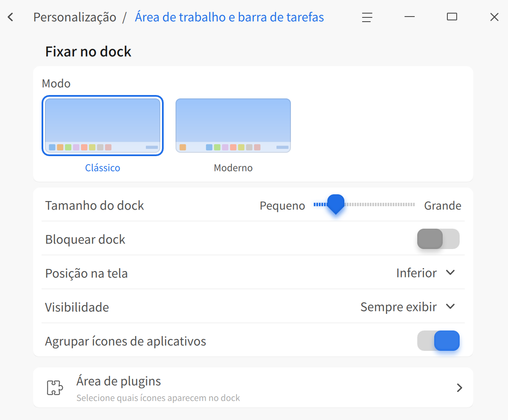

1. Na barra lateral da Central de Controle, selecione **Personalização**.
2. Clique em **Área de trabalho e barra de tarefas**. Você pode:
   - Escolher o modo Clássico ou Centralizado para a barra de tarefas.
   - Arrastar o controle deslizante para alterar o tamanho da barra.
   - Ativar ou desativar **Desativar ajuste livre** para bloquear a altura da barra e evitar alterações acidentais.
   - Definir a posição: superior, inferior, esquerda ou direita.
   - Definir o estado: sempre mostrar, sempre ocultar ou ocultar inteligentemente.
   - Ativar ou desativar **Combinar ícones de aplicativos** para escolher se várias janelas de um aplicativo serão agrupadas em um ícone da barra.
   - Marcar ou desmarcar plug-ins para definir se serão exibidos na barra de tarefas.

No modo de várias telas estendidas, a barra de tarefas pode ser exibida na tela onde o ponteiro está ou somente na tela principal.

#### Efeitos das janelas

Os efeitos das janelas dependem do desempenho do hardware. Alterne entre os modos disponíveis para escolher a melhor experiência de uso.

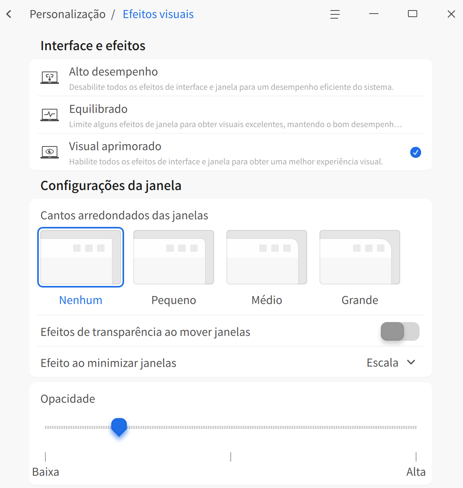

1. Na barra lateral da Central de Controle, selecione **Personalização**.
2. Clique em **Efeitos das janelas**. Você pode:
   - Em **Efeitos da interface**, escolher **Melhor desempenho** para desativar todos os efeitos da interface e das janelas e manter o sistema eficiente.
   - Escolher **Equilibrado** para limitar alguns efeitos e manter uma boa aparência e o funcionamento fluido do sistema.
   - Escolher **Melhor aparência** para ativar todos os efeitos da interface e das janelas.
   - Escolher o arredondamento dos cantos das janelas: nenhum, pequeno, médio ou grande.
   - Ativar ou desativar a transparência ao mover janelas. Quando ativada, a transparência é aplicada durante o movimento.
   - Escolher o efeito de minimização: **Escala** ou **Lâmpada mágica**.
   - Definir a opacidade da barra de tarefas e do lançador no modo de janela pequena. Quanto mais à esquerda estiver o controle deslizante, mais transparente será o elemento.
   - Definir se as barras de rolagem serão exibidas durante a rolagem ou o tempo todo.
   - Arrastar o controle deslizante **Altura da barra de título** para ajustar a altura e visualizar o resultado em tempo real.

>  Observação: esse recurso se aplica somente às barras de título dos aplicativos desenhadas pelo gerenciador de janelas.

#### Papel de parede

Escolha papéis de parede atraentes para personalizar a área de trabalho e dar um visual diferente ao computador.

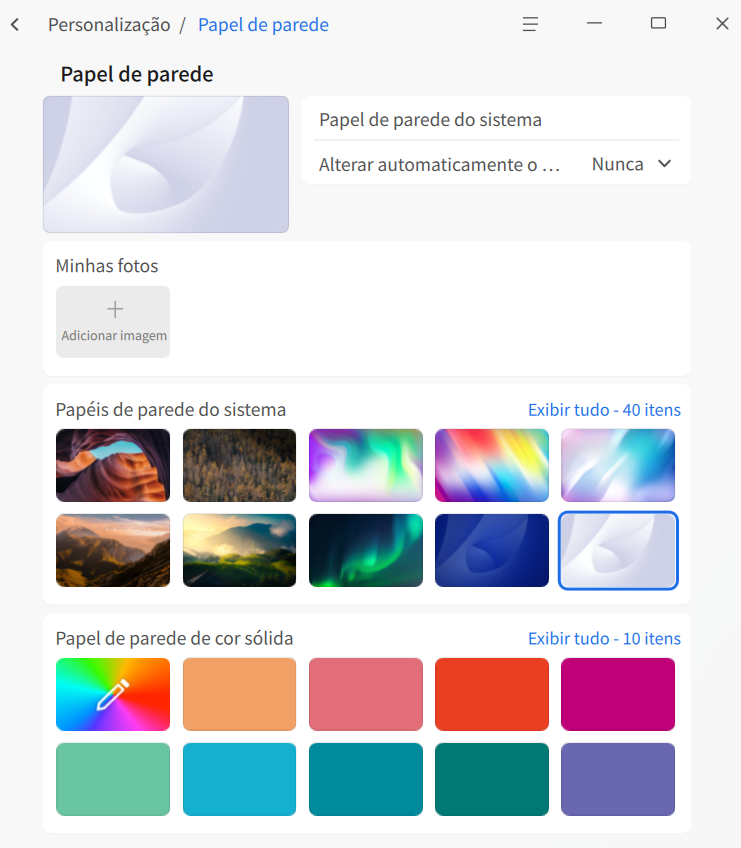

1. Clique com o botão direito do mouse na área de trabalho e selecione **Definir papel de parede** para abrir a pré-visualização de todos os papéis de parede na Central de Controle.
2. Escolha entre **Minhas imagens**, **Papéis de parede do sistema** ou **Cor sólida**.
3. Clique em um papel de parede para aplicá-lo à área de trabalho.
4. Clique com o botão direito do mouse em um papel de parede e selecione **Definir tela de bloqueio** para aplicá-lo à tela de bloqueio.

>  Dica:
> 
> - Em **Alternar papel de parede automaticamente**, defina o intervalo entre as trocas. Você também pode trocar o papel de parede automaticamente ao entrar no sistema ou ao reativá-lo.
> - Você também pode definir uma imagem como papel de parede da área de trabalho no visualizador de imagens ou pesquisar e baixar papéis de parede na loja de aplicativos.

#### Proteção de tela

Os protetores de tela foram criados originalmente para proteger os tubos de imagem. Hoje, eles são usados principalmente para impedir que outras pessoas vejam informações privadas no computador.

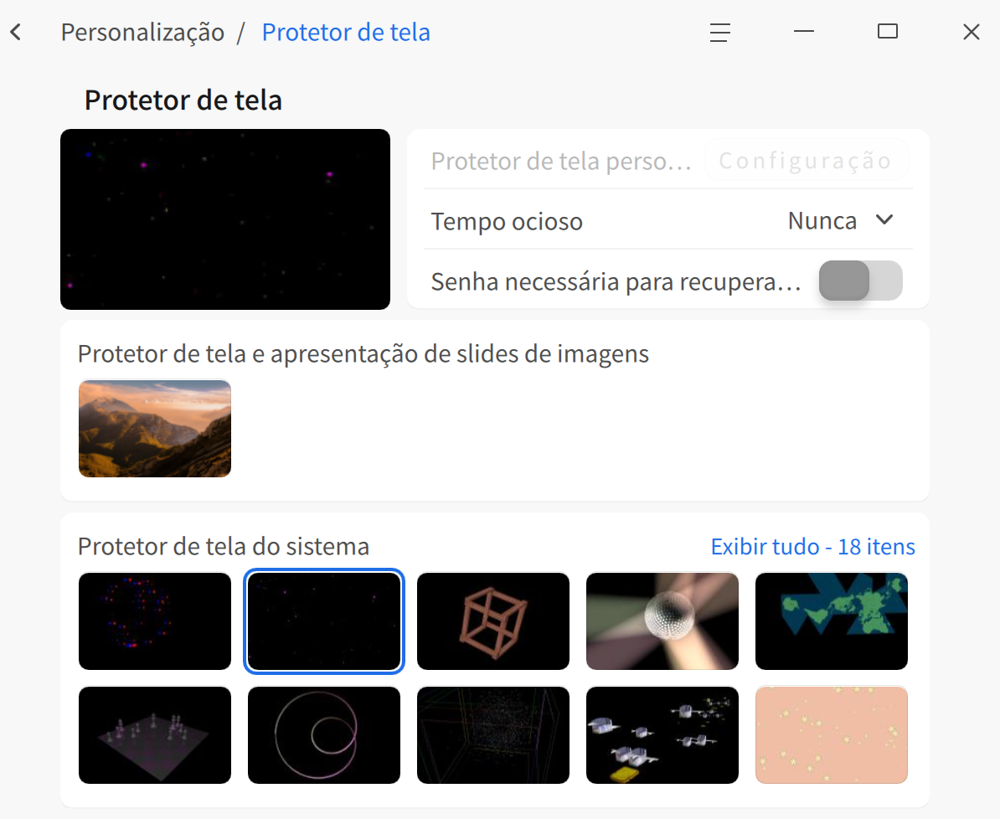

1. Em **Central de Controle > Personalização**, clique em **Proteção de tela** para abrir as configurações e visualizar os protetores disponíveis.
2. Escolha entre apresentação de imagens e protetores de tela do sistema.
3. Depois de selecionar um protetor, defina o tempo de inatividade. Ele será iniciado quando o computador ficar ocioso pelo período especificado.
4. Se escolher a apresentação de imagens, clique em **Configurar** nas opções de personalização para definir a pasta das imagens, o intervalo e a ordem aleatória.
5. Ative **Exigir senha ao reativar** para proteger melhor sua privacidade.

#### Cores e ícones

1. Na barra lateral da Central de Controle, selecione **Personalização**.
2. Clique em **Cores e ícones**. Você pode:
   - Escolher uma cor de destaque e visualizar o resultado em tempo real.
   - Escolher um tema de ícones fornecido pelo sistema, baixado da loja ou importado por você.
   - Clicar em **Tema do cursor** e selecionar um estilo de cursor.

#### Fontes e tamanho do texto

1. Na barra lateral da Central de Controle, selecione **Personalização**.
2. Clique em **Fontes e tamanho do texto**.
3. Defina a fonte e o tamanho do texto do sistema.

### Bluetooth e outros dispositivos

#### Bluetooth

O Bluetooth permite a comunicação sem fio a curta distância. Com ele, você pode conectar dispositivos Bluetooth próximos sem usar a rede nem cabos. Entre os dispositivos comuns estão teclados, mouses, fones de ouvido e alto-falantes Bluetooth.

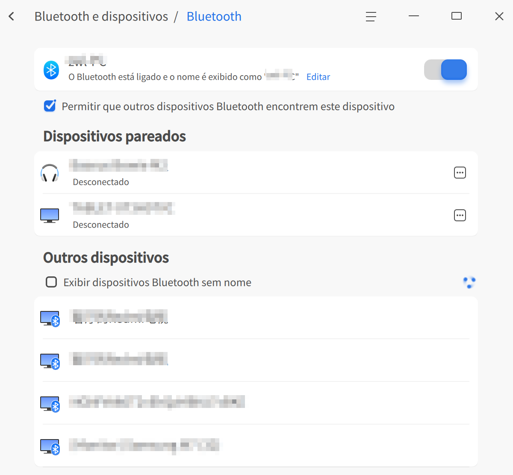

>  Observação: se o notebook tiver Bluetooth integrado, basta ativá-lo. Se o computador de mesa não tiver Bluetooth, conecte um adaptador Bluetooth à porta USB para usar esse recurso.

##### Alterar o nome do Bluetooth

1. Na barra lateral da Central de Controle, selecione **Bluetooth e outros dispositivos** e clique em **Bluetooth**.
2. Clique em **Alterar** ao lado do nome do Bluetooth e digite o novo nome do computador.

>  Observação: depois que o nome do Bluetooth for alterado, o novo nome será transmitido automaticamente. Os outros dispositivos precisarão pesquisar novamente.

##### Conectar dispositivos Bluetooth

1. Na barra lateral da Central de Controle, selecione **Bluetooth e outros dispositivos** e clique em **Bluetooth**.
2. Ative **Bluetooth**. O sistema pesquisará dispositivos próximos e os mostrará na lista **Outros dispositivos**.
3. Clique duas vezes no dispositivo desejado ou clique em **Conectar**. Se solicitado, digite o código de pareamento no dispositivo. Após o pareamento, a conexão será estabelecida automaticamente.
4. Depois de conectado, o dispositivo Bluetooth será adicionado à lista **Meus dispositivos**.
5. Clique no dispositivo nessa lista para **Desconectar** ou alterar o nome.

##### Enviar e receber arquivos por Bluetooth

Use o Bluetooth para enviar e receber arquivos entre um PC UOS e um PC que não seja UOS ou entre um PC UOS e um dispositivo móvel (celular ou tablet).

Pré-requisito: os dispositivos Bluetooth de envio e recebimento já devem estar pareados e conectados.

**Enviar arquivos por Bluetooth de um PC UOS**

Neste caso, o dispositivo de envio transmite arquivos ao dispositivo de recebimento por Bluetooth.

1. Na barra lateral da Central de Controle, selecione **Bluetooth e outros dispositivos** e clique em **Bluetooth**.
2. Ative **Bluetooth**. O sistema pesquisará os dispositivos próximos automaticamente.
3. Em **Meus dispositivos**, selecione um dispositivo pareado e conectado. Clique no botão **Mais** ao lado dele para abrir os detalhes e clique em **Enviar arquivo** (disponível somente para dispositivos Bluetooth de PC, celular ou tablet). Na janela do gerenciador de arquivos, selecione o arquivo e clique em **Abrir**.
4. Na janela **Transferência de arquivos Bluetooth**, selecione o dispositivo de destino e clique em **Enviar** para iniciar a transferência.

**Enviar arquivos por Bluetooth de um celular**

Neste caso, o dispositivo de envio (por exemplo, um celular Android) transmite arquivos ao dispositivo de recebimento por Bluetooth.

1. Ative **Bluetooth**. O sistema pesquisará os dispositivos próximos automaticamente.
2. Selecione o dispositivo Bluetooth pareado e conectado.
3. No celular, selecione um arquivo e clique em **Enviar** para transmiti-lo por Bluetooth.

**Receber arquivos por Bluetooth**

Quando o dispositivo de envio transmite um arquivo, uma janela aparece no dispositivo de recebimento. Clique em **Aceitar** ou **Recusar**.

- Se o dispositivo de recebimento aceitar, o dispositivo de envio iniciará a transferência e exibirá uma janela de progresso. Ao terminar, uma notificação será exibida no dispositivo de recebimento e você poderá abrir o arquivo recebido.
- Os arquivos cuja transferência falhar serão mostrados na lista de falhas nos seguintes casos:
  - O dispositivo de recebimento recusa o arquivo e a transferência é encerrada.
  - O dispositivo de recebimento não responde a tempo ou está fora do alcance; a conexão Bluetooth falha.
  - O dispositivo de recebimento não aceita nem recusa o arquivo. A transferência é encerrada após 1 minuto por padrão.

#### Mouse e touchpad

O mouse e o touchpad são dispositivos de entrada comuns. O mouse torna as operações mais simples e rápidas. Em notebooks, o touchpad pode ser usado no lugar do mouse. Alguns dispositivos também têm um trackpoint, que permite controlar o ponteiro sem tirar os dedos da linha de base do teclado. No módulo de configurações do mouse da Central de Controle, você pode configurar o mouse, o touchpad e o trackpoint conforme suas preferências.

##### Configurações gerais

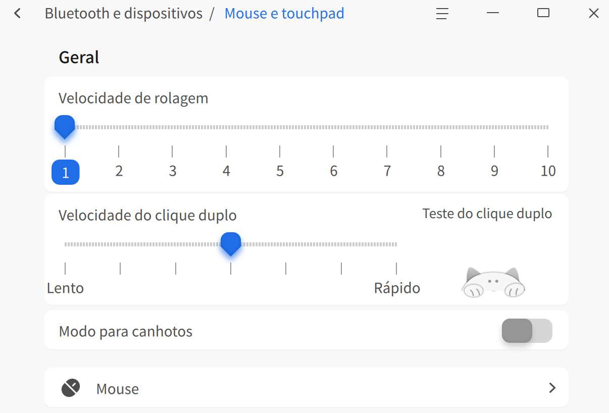

1. Na barra lateral da Central de Controle, selecione **Bluetooth e outros dispositivos** e clique em **Mouse e touchpad**.

2. Configure as opções na área **Geral**:
   
   - Ajuste **Velocidade de rolagem**. Quanto maior o valor definido pelo controle deslizante, mais rápida será a rolagem.
   
   - Ajuste **Velocidade do clique duplo** arrastando o controle deslizante.
   
   - Ative **Modo para canhotos** para usar o mouse com a mão esquerda.
     
 >  Observação: no modo para canhotos, as funções dos botões esquerdo e direito do mouse e do touchpad são invertidas.

##### Configurações do mouse

Depois de conectar um mouse, ajuste as configurações correspondentes na Central de Controle conforme suas preferências.

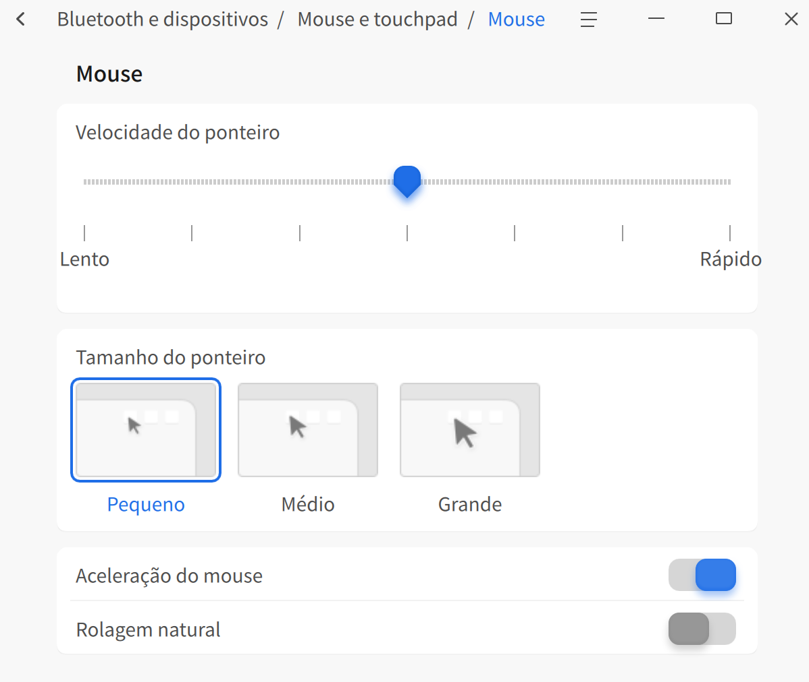

1. Na barra lateral da Central de Controle, selecione **Bluetooth e outros dispositivos** e clique em **Mouse e touchpad**.
2. Clique em **Mouse**.
3. Ajuste **Velocidade do ponteiro** para controlar a velocidade de movimento do ponteiro.
4. Em **Tamanho do ponteiro**, escolha pequeno, médio ou grande.
5. Ative **Aceleração do mouse** para ajustar a resposta ao movimento.
6. Ative **Desativar o touchpad ao conectar um mouse** para desabilitar o touchpad quando um mouse estiver conectado.
7. Ative **Rolagem natural**.

>  Observação:
> 
> - A aceleração do mouse melhora a precisão do ponteiro. Quanto mais rápido o mouse se move, maior é a distância percorrida pelo ponteiro na tela. Ative ou desative a opção conforme necessário.
> - **Desativar o touchpad ao conectar um mouse** não é exibido quando o dispositivo não tem touchpad.
> - Com a rolagem natural ativada, o conteúdo acompanha a direção da roda do mouse: para baixo, o conteúdo rola para baixo; para cima, rola para cima.

##### Configurações do touchpad

Se estiver usando um notebook, ative **Desativar o touchpad durante a digitação** em **Mouse e touchpad > Mouse** para evitar toques acidentais.

Você também pode ajustar **Velocidade do ponteiro** para controlar a velocidade do ponteiro e ativar a rolagem natural para mudar a direção da rolagem.

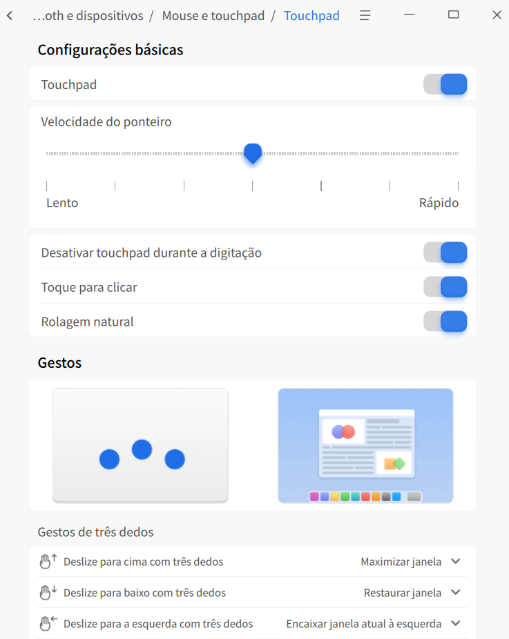

**Configurar gestos**

Os gestos do touchpad permitem acessar rapidamente funções da área de trabalho. É possível configurar gestos com três e quatro dedos.

**Gestos com três dedos**: configure as seguintes ações:

1. Deslizar três dedos para cima: por padrão, maximiza a janela. Você pode alterar para restaurar a janela, dividir a janela atual à esquerda ou à direita, ou desativar.
2. Deslizar três dedos para baixo: por padrão, restaura a janela. Você pode alterar para maximizar a janela, dividir a janela atual à esquerda ou à direita, ou desativar.
3. Deslizar três dedos para a esquerda: por padrão, divide a janela atual à esquerda. Você pode alterar para restaurar ou maximizar a janela, dividi-la à direita ou desativar.
4. Deslizar três dedos para a direita: por padrão, divide a janela atual à direita. Você pode alterar para restaurar ou maximizar a janela, dividi-la à esquerda ou desativar.
5. Tocar com três dedos: por padrão, abre ou oculta a pesquisa global. Você pode alterar para mostrar ou ocultar o lançador, abrir ou fechar a área de transferência ou a Central de mensagens, ou desativar.

**Gestos com quatro dedos**: configure as seguintes ações:

1. Deslizar quatro dedos para cima: por padrão, mostra a visão multitarefa. Você pode alterar para ocultá-la, alternar para a área de trabalho anterior ou seguinte, mostrar ou ocultar a área de trabalho, ou desativar.
2. Deslizar quatro dedos para baixo: por padrão, oculta a visão multitarefa. Você pode alterar para mostrá-la, alternar para a área de trabalho anterior ou seguinte, mostrar ou ocultar a área de trabalho, ou desativar.
3. Deslizar quatro dedos para a esquerda: por padrão, alterna para a área de trabalho anterior. Você pode alterar para mostrar ou ocultar a visão multitarefa, alternar para a próxima área de trabalho, mostrar ou ocultar a área de trabalho, ou desativar.
4. Deslizar quatro dedos para a direita: por padrão, alterna para a próxima área de trabalho. Você pode alterar para mostrar ou ocultar a visão multitarefa, alternar para a área de trabalho anterior, mostrar ou ocultar a área de trabalho, ou desativar.
5. Tocar com quatro dedos: por padrão, abre ou fecha o lançador. Você pode alterar para abrir ou fechar a pesquisa global, a área de transferência ou a Central de notificações, ou desativar.

#### Teclado

Neste módulo, configure as propriedades do teclado de acordo com suas preferências de digitação, os métodos de entrada e os atalhos personalizados.

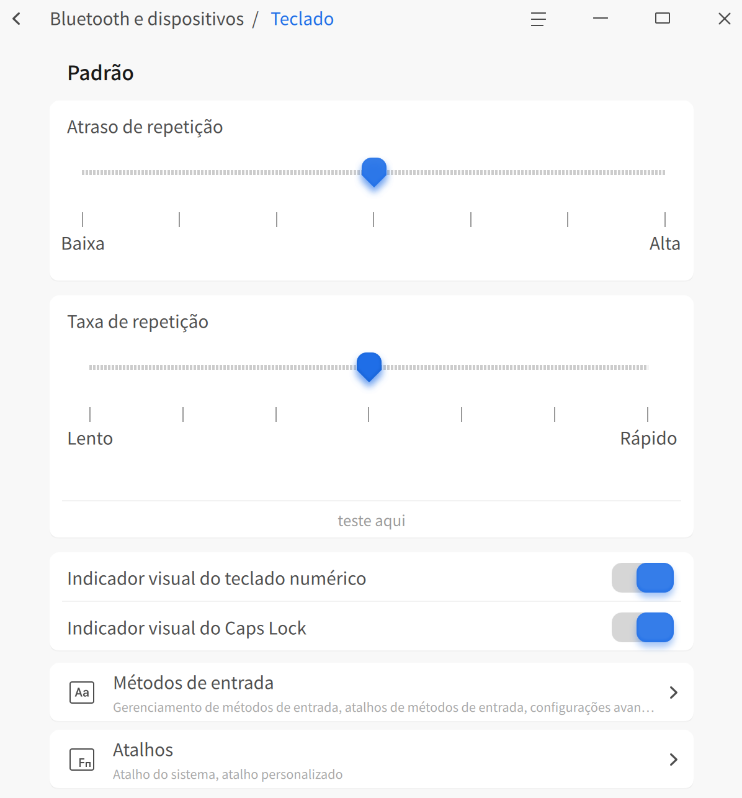

##### Propriedades do teclado

1. Na barra lateral da Central de Controle, selecione **Bluetooth e outros dispositivos** e clique em **Teclado**.
2. Configure as opções na área **Geral**.
3. Ajuste **Atraso de repetição** e **Velocidade de repetição**.
4. Clique em "Teste aqui" e mantenha uma tecla pressionada para conferir o resultado.
5. Ative **Habilitar teclado numérico** ou **Aviso de Caps Lock** conforme necessário.

##### Método de entrada

Configure os métodos de entrada para ampliar as opções de digitação do sistema. Na tela correspondente, você pode adicionar vários métodos de entrada e definir atalhos para alternar entre eles conforme suas preferências.

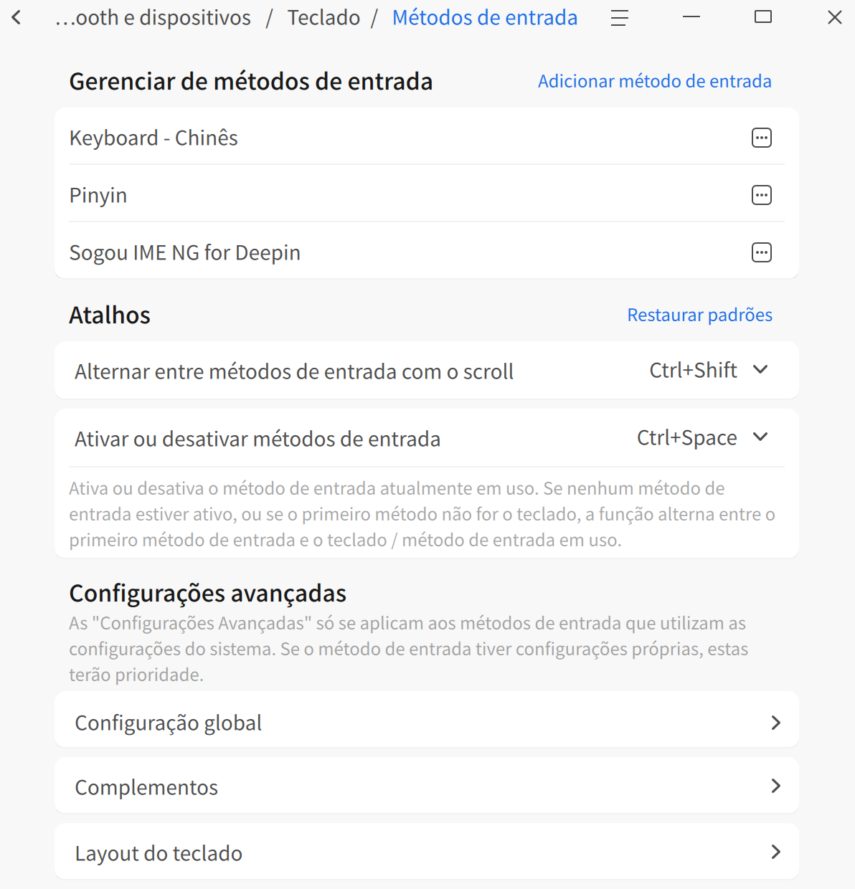

**Adicionar um método de entrada**

Adicione vários métodos de entrada à lista de gerenciamento para alternar entre eles.

1. Na barra lateral da Central de Controle, selecione **Bluetooth e outros dispositivos** e clique em **Teclado**.
2. Clique em **Método de entrada**.
3. Clique em **Adicionar método de entrada** e escolha uma opção:
   - Clique em **Baixar na loja** para baixar um método de entrada da loja de aplicativos. Depois do download, ele será definido automaticamente como padrão.
   - Na tela para adicionar métodos de entrada, selecione um método para incluí-lo na lista de gerenciamento.

>  Observação: na tela de gerenciamento, clique em **Editar** e depois em **Remover** para excluir um método de entrada da lista. Os métodos removidos, mas não desinstalados, podem ser adicionados novamente na tela de adição.

**Organizar métodos de entrada**

1. Na barra lateral da Central de Controle, selecione **Bluetooth e outros dispositivos** e clique em **Teclado**.
2. Clique em **Método de entrada**.
3. Na área de gerenciamento, arraste os métodos de entrada para cima ou para baixo para organizá-los.

**Configurar um método de entrada**

1. Na barra lateral da Central de Controle, selecione **Bluetooth e outros dispositivos** e clique em **Teclado**.
2. Clique em **Método de entrada**.
3. Na área de gerenciamento, clique em **Configurações** ao lado do método de entrada para ajustar as opções específicas dele.

**Definir o atalho para alternar métodos de entrada**

1. Na barra lateral da Central de Controle, selecione **Bluetooth e outros dispositivos** e clique em **Teclado**.
2. Clique em **Método de entrada**.
3. Na área de atalhos, escolha um atalho na lista para alternar métodos de entrada.

>  Observação: você pode configurar mais atalhos nas configurações avançadas do método de entrada.

**Configurações avançadas**

1. Na barra lateral da Central de Controle, selecione **Bluetooth e outros dispositivos** e clique em **Teclado**.
2. Clique em **Método de entrada**.
3. Clique em **Configurações avançadas** para configurar globalmente o método de entrada, incluindo atalhos adicionais, programas, saída, aparência e componentes complementares.

**Layout do teclado**

O layout do teclado permite configurar um teclado personalizado para o idioma atual. Depois de definir o layout, os caracteres correspondentes serão exibidos na tela quando você pressionar as teclas. Os caracteres exibidos podem ser diferentes dos impressos nas teclas.

O layout geralmente é definido durante a instalação do sistema. Você pode adicionar ou remover outros layouts conforme necessário.

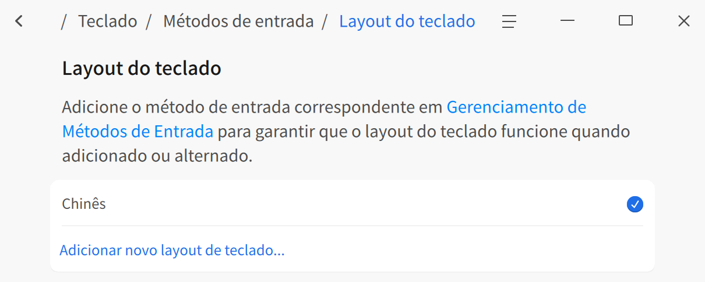

**Adicionar um layout do teclado**

1. Na barra lateral da Central de Controle, selecione **Bluetooth e outros dispositivos** e clique em **Teclado**.
2. Clique em **Layout do teclado**.
3. Clique em **Adicionar layout do teclado** e selecione um layout para incluí-lo na lista.

**Remover um layout do teclado**

1. Na barra lateral da Central de Controle, selecione **Bluetooth e outros dispositivos** e clique em **Teclado**.
2. Clique em **Layout do teclado**.
3. Clique em **Editar** ao lado de "Layout do teclado".
4. Clique em **Remover** para excluir o layout.

##### Atalhos

A lista de atalhos mostra todos os atalhos do sistema. Nela, você pode consultá-los, alterá-los e criar atalhos personalizados.

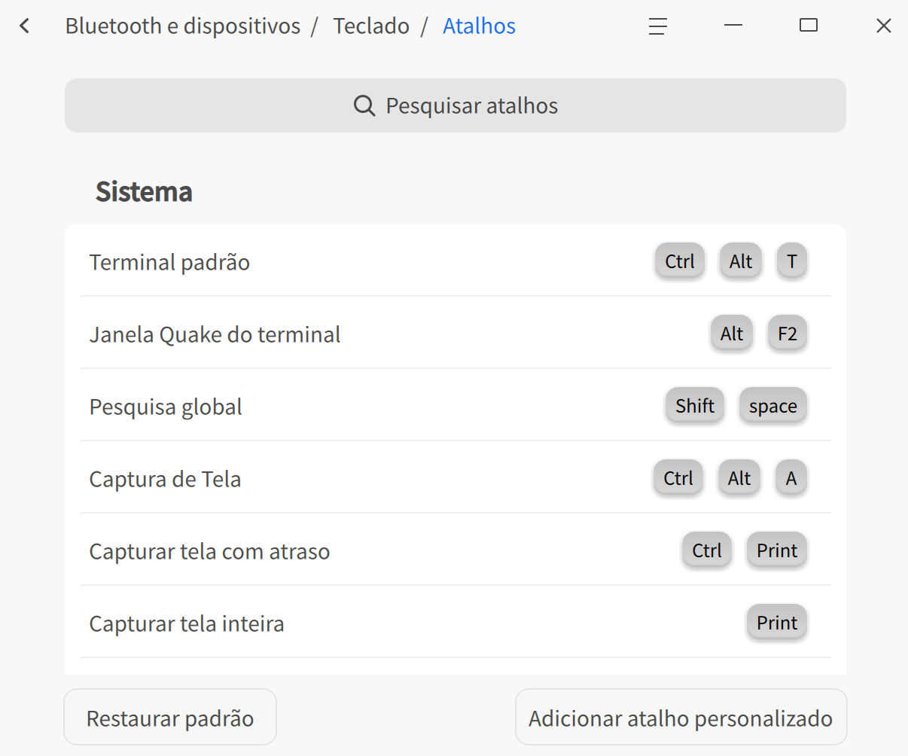

**Consultar atalhos**

1. Na barra lateral da Central de Controle, selecione **Bluetooth e outros dispositivos** e clique em **Teclado**.
2. Clique em **Atalhos**.
3. Pesquise ou consulte os atalhos padrão do sistema, das janelas e dos espaços de trabalho.

**Alterar um atalho**

1. Na barra lateral da Central de Controle, selecione **Bluetooth e outros dispositivos** e clique em **Teclado**.
2. Clique em **Atalhos**.
3. Clique no atalho que deseja alterar.
4. Digite o novo atalho no teclado.

>  Dica: para desativar um atalho, pressione **Backspace** . Para cancelar a alteração, pressione **Esc** ou clique em **Restaurar padrão** abaixo.

**Criar um atalho personalizado**

Você pode criar um atalho para os aplicativos que usa com frequência.

1. Na barra lateral da Central de Controle, selecione **Bluetooth e outros dispositivos** e clique em **Teclado**.
2. Clique em **Atalhos**.
3. Clique em **Adicionar** para abrir a tela de criação de atalhos personalizados.
4. Digite o nome, o comando e a combinação de teclas.
5. Clique em **Adicionar**.
6. Depois de adicionar o atalho, clique em **Editar** ao lado de "Atalhos personalizados".
7. Clique no botão de remoção ao lado do atalho para excluí-lo.

>  Dica: para alterar a combinação de teclas, clique nela e digite a nova combinação. Para alterar o nome ou o comando de um atalho personalizado, clique em **Editar** ao lado de "Atalhos personalizados" e depois em  ao lado do nome do atalho.

#### Tela sensível ao toque

Quando uma tela sensível ao toque estiver conectada, você poderá selecioná-la e ajustá-la.

1. Na barra lateral da Central de Controle, selecione **Bluetooth e outros dispositivos** e clique em **Tela sensível ao toque**.
2. Configure a tela e clique em **OK**.

#### Mesa digitalizadora

Uma mesa digitalizadora, também chamada de tablet gráfico, é um dispositivo de entrada usado principalmente para desenhar. Depois de conectá-la ao computador, você pode ajustar a sensibilidade à pressão da caneta e da borracha.

>  Observação: este módulo só aparece depois que uma mesa digitalizadora é conectada.

1. Na barra lateral da Central de Controle, selecione **Bluetooth e outros dispositivos** e clique em **Mesa digitalizadora**.
2. Selecione o modo **Caneta**.
3. Ajuste a **Sensibilidade à pressão**.

### Gerenciamento de energia

Configure a energia do sistema para prolongar a duração da bateria do notebook e aumentar a segurança do sistema.

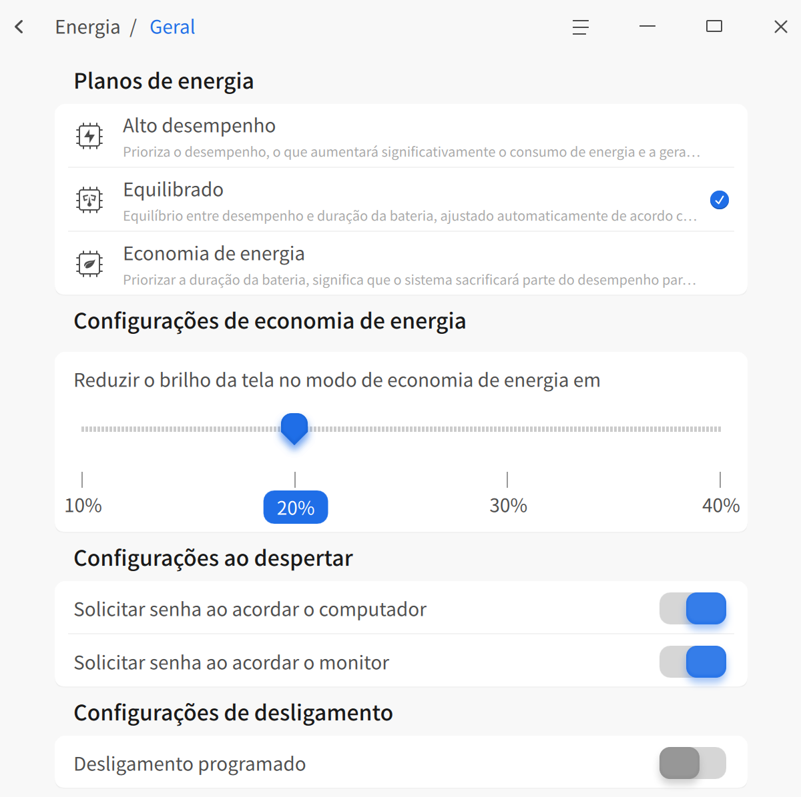

#### Ajustar o modo de desempenho

1. Na barra lateral da Central de Controle, selecione **Gerenciamento de energia**.
2. Clique em **Geral**.
3. Em Modo de desempenho, selecione **Equilibrado**, **Alto desempenho** ou **Economia de energia**.

#### Configurar o modo de economia de energia

Configure o modo de economia de energia e reduza o brilho da tela para diminuir o consumo de energia do computador.

1. Na barra lateral da Central de Controle, selecione **Gerenciamento de energia**.
2. Clique em **Geral**.
3. Em Economia de energia:
   - Ative **Ativar automaticamente quando a bateria estiver fraca** (disponível somente em notebooks).
   - Em **Limite de bateria fraca**, selecione o nível de bateria em que o modo será ativado automaticamente.
   - Ative **Ativar automaticamente ao usar a bateria** (disponível somente em notebooks).
   - Arraste o controle **Reduzir o brilho automaticamente** para ajustar o brilho da tela quando o modo estiver ativo.

#### Configurações de reativação

1. Na barra lateral da Central de Controle, selecione **Gerenciamento de energia**.
2. Clique em **Geral**.
3. Em Configurações de reativação:
   - Ative **Exigir senha ao sair da suspensão** para exigir um novo login quando o computador sair da suspensão.
   - Ative **Exigir senha ao reativar a tela** para exigir um novo login ao reativar a tela.

#### Configurações de desligamento

1. Na barra lateral da Central de Controle, selecione **Gerenciamento de energia**.
2. Clique em **Geral**.
3. Em **Configurações de desligamento**:
   - Defina **Horário do desligamento programado** digitando a hora ou ajustando o controle.
   - Em **Frequência**, escolha uma vez, dias úteis, todos os dias ou uma frequência personalizada.

#### Definir quando desligar a tela

1. Na barra lateral da Central de Controle, selecione **Gerenciamento de energia**.
2. Clique em **Usando energia** ou **Usando bateria**.
3. Selecione quando desligar a tela.

>  Observação: em notebooks, você pode definir horários diferentes para a mesma opção em **Usando energia** e **Usando bateria**.

#### Definir quando suspender o computador

1. Na barra lateral da Central de Controle, selecione **Gerenciamento de energia**.
2. Clique em **Usando energia** ou **Usando bateria**.
3. Selecione quando suspender o computador.

>  Dica: em notebooks, você também pode ativar **Suspender ao fechar a tampa** para suspender o computador ao fechar a tampa quando estiver usando a energia elétrica.

#### Definir quando bloquear a tela automaticamente

1. Na barra lateral da Central de Controle, selecione **Gerenciamento de energia**.
2. Clique em **Usando energia** ou **Usando bateria**.
3. Selecione quando bloquear a tela automaticamente.

#### Definir a ação ao fechar a tampa

1. Na barra lateral da Central de Controle, selecione **Gerenciamento de energia**.
2. Clique em **Usando energia** ou **Usando bateria**.
3. Em **Ao fechar a tampa do notebook**, escolha **Suspender**, **Hibernar**, **Desligar a tela** ou **Não fazer nada**.

>  Observação: a configuração da ação ao fechar a tampa está disponível somente em notebooks.

#### Definir a ação do botão liga/desliga

1. Na barra lateral da Central de Controle, selecione **Gerenciamento de energia**.
2. Clique em **Usando energia** ou **Usando bateria**.
3. Defina o que acontece ao pressionar o botão liga/desliga: **Desligar**, **Suspender**, **Hibernar**, **Desligar a tela**, **Abrir a tela de desligamento** ou **Não fazer nada**.

#### Gerenciamento de bateria fraca

1. Na barra lateral da Central de Controle, selecione **Gerenciamento de energia**.
2. Clique em **Usando bateria**.
3. Configure o gerenciamento de bateria fraca:
   - Ative **Aviso de bateria fraca** para receber uma notificação quando a carga ficar abaixo do limite definido (por exemplo, 20%).
   - Defina a ação automática para bateria fraca: suspensão ou hibernação.
   - Escolha na lista suspensa o limite de carga para entrar no estado de bateria fraca.

>  Observação: o aviso de bateria fraca está disponível somente em notebooks.

#### Gerenciamento da bateria

1. Na barra lateral da Central de Controle, selecione **Gerenciamento de energia**.
2. Clique em **Usando bateria**.
3. Na área **Gerenciamento da bateria**:
   - Ative **Exibir tempo restante de uso e de carregamento** para ajustar as informações da bateria exibidas na barra de tarefas.
   - Consulte a capacidade máxima da bateria.

### Contas

Uma conta é criada durante a instalação do sistema. No módulo de contas da Central de Controle, você pode alterar as configurações da conta ou criar outra.

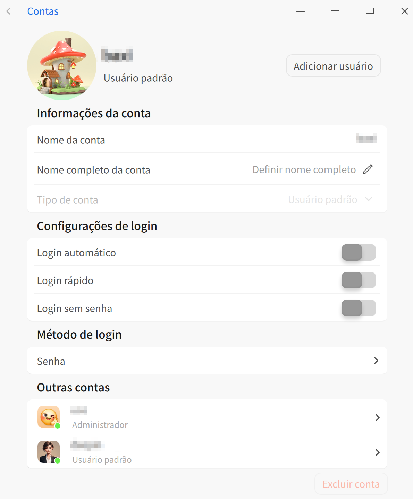

#### Criar uma conta

1. Clique em **Adicionar novo usuário**.
2. Escolha o tipo de conta e defina o nome de usuário, o nome completo, a senha, a confirmação da senha e a dica de senha.
3. Clique em **Criar**.
4. Digite a senha da conta atual na caixa de autorização. A nova conta será adicionada à lista.

>  Dica: você também pode alterar o tipo de uma conta padrão para administrador.

#### Alterar a imagem do perfil

Passe o ponteiro sobre a imagem do perfil da conta para exibir **Editar**. Clique na imagem, escolha um avatar ou adicione uma imagem local para substituí-la.

#### Definir o nome completo

O nome completo da conta aparece na lista de contas e na tela de login do sistema. Defina-o conforme necessário.

Clique em  ao lado de **Definir nome completo** e digite o nome completo da conta.

#### Login automático

Com o **Login automático** ativado, o sistema abrirá diretamente a área de trabalho na próxima inicialização ou reinicialização. Ainda será necessária uma senha para entrar depois de bloquear a tela ou sair da sessão.

Ative **Login automático** e digite a senha da conta atual na caixa de autorização para habilitar o recurso.

#### Login sem senha

Com o **Login sem senha** ativado, não será necessária uma senha para entrar no sistema após iniciar, reiniciar ou sair da sessão, nem para desbloquear a tela.

Ative **Login sem senha** e digite a senha da conta atual na caixa de autorização para habilitar o login sem senha.

>  Dica:
> 
> - Se **Login sem senha** e **Login automático** estiverem ativados ao mesmo tempo, o sistema abrirá diretamente a área de trabalho na próxima inicialização ou reinicialização.

#### Métodos de login

Edite e configure os métodos de login disponíveis.

**Senha: alterar a senha**

1. Clique em **Senha** para abrir a página de configurações.
2. Digite a senha atual, a nova senha e a confirmação da nova senha. Clique em **Salvar**.

>  Observação: se a senha da conta de administrador expirar, altere-a antes de autorizar operações.

**Senha: validade da senha**

1. Clique em **Senha** para abrir a página de configurações.
2. Defina por quantos dias a senha será válida ou escolha validade permanente.

> O prazo de validade começa na data em que a senha é alterada.
> 
> Por exemplo: se o usuário A alterar a senha em 1º de setembro e definir a validade como 30 dias, a senha poderá ser usada normalmente de 1º a 30 de setembro.

**Autenticação biométrica**

A autenticação biométrica identifica uma pessoa por meio de características físicas ou comportamentais. Os métodos comuns incluem reconhecimento de impressão digital e reconhecimento facial.

Depois de conectar um dispositivo de autenticação biométrica, cadastre suas impressões digitais ou seus dados faciais no sistema. Esses dados podem ser usados para entrar no sistema, desbloquear a tela e autorizar operações especiais, além de melhorar a experiência, a eficiência e a segurança do sistema.

>  Observação: o módulo de autenticação biométrica só aparece quando um dispositivo compatível está conectado. Só então será possível configurar senhas por impressão digital ou reconhecimento facial.

**Configurar uma senha por impressão digital**

A impressão digital é formada pelos sulcos e relevos na ponta dos dedos. Em geral, ela é única para cada pessoa e pode ser usada como senha.

1. Abra a página de autenticação biométrica e clique em **Adicionar nova impressão digital** na área de impressões digitais.
2. Digite a senha da conta atual na caixa de autorização e use o dispositivo de leitura para cadastrar a impressão digital.
3. Quando o cadastro for concluído, clique em **Concluir**.

>  Observação: você pode adicionar várias impressões digitais e removê-las individualmente.

**Configurar o reconhecimento facial**

1. Abra a página de autenticação biométrica e clique em **Adicionar novo rosto** na área de reconhecimento facial.
2. Na caixa de diálogo exibida, marque **Li e concordo com o "Termo de responsabilidade do usuário"** e clique em **Avançar**.
3. Clique em **Concordar e iniciar o cadastro facial** e depois em **Avançar**. Use o dispositivo de reconhecimento facial para cadastrar os dados do rosto.
4. Clique em **Concluir**.

>  Observação: cada conta pode cadastrar até cinco rostos.

**Chave de segurança**

A chave de segurança é um dispositivo físico de autenticação. Cadastre-a no sistema para entrar, desbloquear a tela e autorizar operações especiais sem usar a senha tradicional da conta.

**Registrar um dispositivo**

1. Na barra lateral da Central de Controle, selecione **Contas**, abra **Métodos de login** e clique em **Chave de segurança**.
2. Quando o sistema solicitar **Insira a chave de segurança**, conecte o dispositivo. O sistema o reconhecerá automaticamente.
3. Depois do reconhecimento, siga a instrução **Verifique a chave de segurança tocando ou deslizando o dedo no dispositivo**. Se a verificação expirar, clique em **Tentar novamente** ou desconecte e conecte o dispositivo outra vez.
4. Depois da verificação:
   - Se o dispositivo ainda não estiver registrado, o sistema informará **Chave de segurança não adicionada detectada. Adicione-a para usá-la na autenticação de login.** Clique em **Adicionar dispositivo**.
   - Se o dispositivo já estiver registrado, a tela de gerenciamento da chave de segurança será aberta.
5. Clique em **Adicionar dispositivo** e siga a instrução **Verifique a chave de segurança tocando ou deslizando o dedo no dispositivo**. Depois da verificação, o sistema registrará o dispositivo e abrirá a tela de gerenciamento.

**Gerenciar dispositivos**
**Definir o PIN da chave de segurança**

1. Abra **Gerenciar chave de segurança** e clique em **Definir** ao lado de **PIN da chave de segurança**.
2. No formulário exibido, digite o **Novo PIN** e confirme-o.
3. Clique em **Cancelar** para fechar o formulário. Se o sistema informar que a chave não está registrada, clique em **Registrar** para registrá-la novamente.
4. Clique em **Confirmar**. O sistema verificará as informações.

**Alterar o PIN da chave de segurança**

1. Abra **Gerenciar chave de segurança** e clique em **Alterar** ao lado de **PIN da chave de segurança**.
2. Na caixa de diálogo, digite o **PIN antigo**, o **Novo PIN** e a confirmação do PIN.
3. Clique em **Cancelar** para fechar a caixa de diálogo e encerrar a operação.
4. Clique em **Confirmar**. O sistema verificará as informações.

**Redefinir o PIN da chave de segurança**

1. Abra **Gerenciar chave de segurança** e clique em **Redefinir** ao lado de **Redefinir chave de segurança**.
2. Na caixa de confirmação, clique em **Cancelar** para fechá-la e encerrar a operação.
3. Clique em **Avançar** e reconecte o dispositivo quando solicitado.

**Entrar com uma chave de segurança**

1. Depois de registrar a chave, clique no ícone da chave de segurança na tela de login ou de bloqueio para selecioná-la como método de autenticação.
2. Quando o sistema solicitar **Insira a chave de segurança**, conecte o dispositivo.

#### Excluir uma conta

1. Clique em outra conta que não esteja conectada.
2. Clique em **Excluir conta**.
3. Na tela de confirmação, clique em **Excluir**.

>  Atenção: não é possível excluir uma conta conectada.

### UOS ID

Para usar os recursos do UOS ID, primeiro registre-se e entre na conta. Se ainda não tiver uma conta UOS ID, registre-se de uma das seguintes formas:

- **Pelo site oficial da UnionTech**: acesse o site oficial da UnionTech (há várias opções, como leitura de um código QR pelo WeChat ou uso de um número de celular) e conclua o cadastro.
- **Pela Central de Controle**:
  1. Na tela do UOS ID da Central de Controle, clique em **Entrar**. A tela de login do UOS ID será aberta.
  2. Na tela de login, clique em **Registrar** para abrir a tela de cadastro do UOS ID.
  3. Conclua o cadastro usando um número de celular ou o WeChat.

Depois de entrar no UOS ID, você também poderá usar serviços na nuvem em aplicativos como Sincronização na nuvem, Loja de aplicativos e Navegador.

>   Dica: depois de vincular o UOS ID à conta local, você poderá redefinir a senha de login da conta local usando o UOS ID.

Quando a sincronização na nuvem estiver ativada, o sistema sincronizará automaticamente várias configurações, como som, energia, mouse, atualizações e proteção de tela. Para usar as mesmas configurações em outro computador, entre com a mesma conta UOS ID e sincronize as configurações da nuvem com o novo dispositivo com um clique.

>    Observação:
> 
> 1. A sincronização automática de configurações só está disponível quando o sistema está ativado ou no período de avaliação. Esse recurso não pode ser usado quando o sistema não está ativado.
> 2. Quando **Sincronizar configurações automaticamente** está ativado, você pode escolher os itens que serão sincronizados. Quando está desativado, nenhum item é sincronizado.

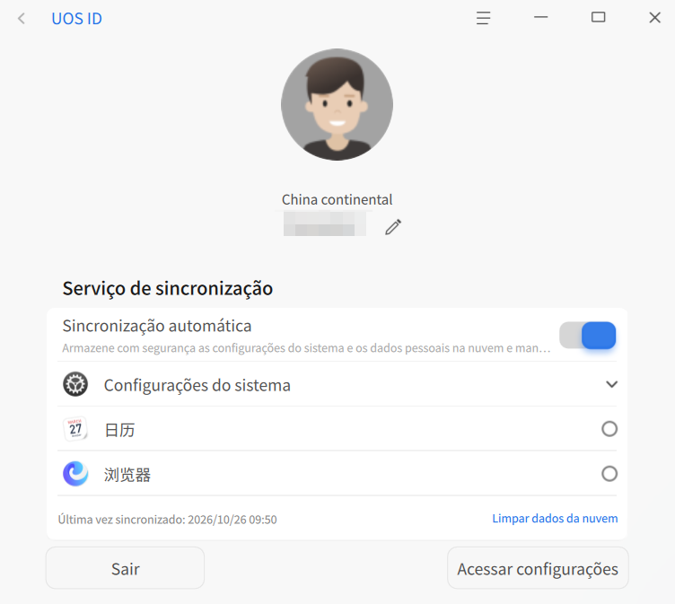

### Privacidade e segurança

- Nas configurações de privacidade e segurança, você pode gerenciar as permissões de acesso dos aplicativos à câmera, aos arquivos e às pastas. Por padrão, todos os aplicativos podem acessar a câmera, os arquivos e as pastas. No momento, o sistema permite controlar o acesso às pastas **Imagens** e **Documentos**.

- Quando uma permissão está ativada, o aplicativo pode acessar o recurso correspondente. Quando ela está desativada, o acesso é bloqueado e o sistema solicita que você ative a permissão em **Central de Controle > Privacidade e segurança** ou ignore a solicitação.

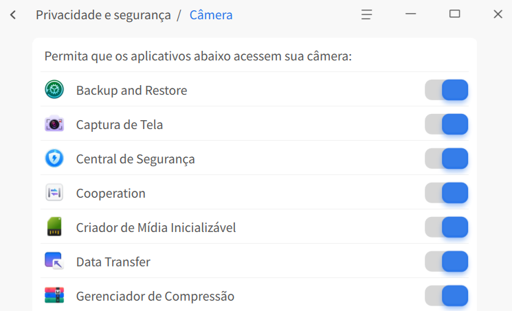

#### Câmera

- Gerencie a permissão de acesso à câmera de cada aplicativo. Clique em  para desativá-la ou em  para ativá-la novamente.

#### Arquivos e pastas

- Gerencie separadamente o acesso de cada aplicativo às pastas **Imagens** e **Documentos**. Clique em  para desativar uma permissão ou em  para ativá-la novamente.

### Atualização do sistema

Na página de configurações de atualização, habilite **Atualizações do sistema** ou **Atualizações de segurança** entre os tipos de atualização dos repositórios para que o download automático e os avisos de atualização funcionem corretamente.

Quando houver uma atualização, a barra lateral da Central de Controle exibirá um aviso. Clique em **Atualização do sistema** para abrir **Verificar atualizações** e clique em **Verificar atualizações**. Depois da verificação, você poderá baixar e instalar as atualizações. Também é possível configurar o download automático no módulo de configurações de atualização.

>  Dica: se não quiser que o sistema verifique atualizações automaticamente nem receba avisos de atualização do sistema ou dos aplicativos, desative **Avisos de atualização** em **Configurações de atualização**.

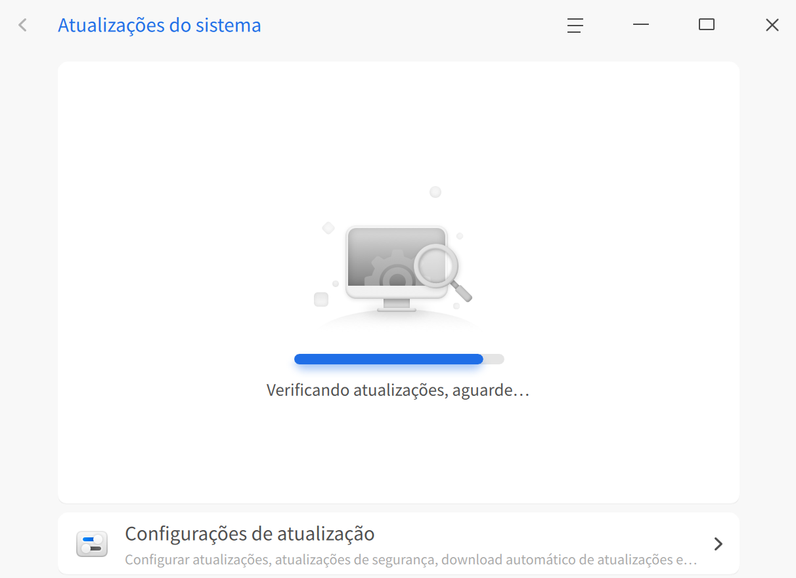

#### Atualizar e fazer upgrade

1. Na barra lateral da Central de Controle, selecione **Atualização do sistema**.
2. Clique em **Verificar atualizações** ou **Verificar novamente** para abrir a tela de verificação.
   - Se não houver atualizações, a mensagem "Seu sistema está atualizado" será exibida.
   - Se houver atualizações, serão exibidos o botão **Baixar**, as caixas de seleção do conteúdo, o tamanho do download e os detalhes. Continue com as etapas 3 e 4.
3. Clique em **Baixar**. O sistema começará a baixar o conteúdo selecionado.
4. Quando o download terminar, o sistema avisará que as atualizações estão prontas. No módulo de atualização da Central de Controle, clique em **Instalar atualizações** para iniciar a instalação.
5. Quando a atualização terminar, será exibida uma mensagem de sucesso. Reinicie, desligue ou cancele conforme necessário.

#### Atualizar e desligar/reiniciar

Depois de iniciar a instalação, você pode escolher **Atualizar em segundo plano**, **Atualizar e desligar** ou **Atualizar e reiniciar**.

- Atualizar em segundo plano: a instalação ocorre em segundo plano e não interfere no uso normal do sistema.
- Atualizar e desligar/reiniciar: uma janela modal mostra o progresso da instalação. O sistema não poderá ser usado durante esse processo e será desligado ou reiniciado automaticamente quando a instalação terminar.

>  Observação: **Atualizar e desligar/reiniciar** é adequado para períodos sem supervisão (por exemplo, após o expediente) e pode ser mais estável do que a atualização em segundo plano.

#### Conteúdo da atualização

1. Na barra lateral da Central de Controle, selecione **Atualização do sistema**.
2. Depois de verificar as atualizações, o conteúdo disponível e as notas da versão serão exibidos automaticamente.

>  Observação: quando somente **Atualizações de segurança** está ativado, o sistema instala apenas atualizações relacionadas a vulnerabilidades de segurança e compatibilidade.

#### Configurações de atualização

##### Tipos de atualização

1. Na barra lateral da Central de Controle, selecione **Atualização do sistema**.
2. Clique em **Configurações de atualização**.
3. Em **Tipos de atualização**, escolha quais atualizações verificar: recursos, segurança ou repositórios de terceiros.

##### Configurações avançadas

1. Na barra lateral da Central de Controle, selecione **Atualização do sistema**.
2. Clique em **Configurações de atualização**.
3. Ative **Limite de velocidade de download** para definir a velocidade máxima. O limite padrão é 10240 KB/s.
4. Ative **Download automático** e defina o período para baixar atualizações. Quando houver atualizações, os dados serão baixados automaticamente dentro do horário especificado.
5. Ative **Avisos de atualização** para receber notificações sobre novas atualizações.
6. Ative **Limpar cache de pacotes** para remover automaticamente os pacotes de atualização baixados e instalados.

>  Dica: ative **Limpar cache de pacotes** para que o sistema limpe periodicamente o cache criado pelos pacotes baixados.

#### Consultar o histórico de atualizações

Clique em **Ver histórico de atualizações** para consultar os registros de todas as versões do sistema instaladas.

## Gerenciador de janelas

O gerenciador de janelas pode exibir diferentes janelas em espaços de trabalho distintos. Use vários espaços de trabalho ao mesmo tempo para agrupar e gerenciar as janelas da área de trabalho.

>  Observação: o gerenciador de janelas só funciona quando os efeitos das janelas estão ativados em **Central de Controle > Personalização > Interface geral**.

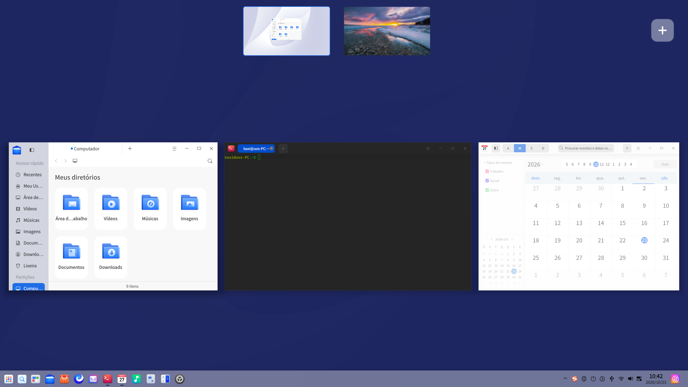

>  Observação: no touchpad, deslize quatro ou cinco dedos para cima para mostrar a visão multitarefa e, em seguida, para baixo para ocultá-la. Esse gesto corresponde ao atalho **Super** + **S**.

### Abrir espaços de trabalho

Os espaços de trabalho permitem agrupar janelas da área de trabalho e ampliar a área de trabalho disponível.

Pressione **Super** + **S** ou clique em  para abrir a tela dos espaços de trabalho.

>  Observação: em computadores com tela sensível ao toque, deslize para cima a partir da borda inferior por uma distância maior que a altura da barra de tarefas para abrir os espaços de trabalho.

### Adicionar um espaço de trabalho

Na tela dos espaços de trabalho, use uma destas opções para adicionar um espaço:

- Clique em **+** no canto superior direito do espaço de trabalho.
- Pressione **Alt** + **+** no teclado.

>  Observação: não é possível adicionar mais espaços de trabalho depois de atingir o limite de **6**.

### Alternar entre espaços de trabalho
Na área de trabalho ou na tela dos espaços de trabalho, use uma destas opções para alternar:

- Na área de trabalho, pressione **Super** +  /  para alternar para o espaço anterior ou seguinte.
- Na área de trabalho, pressione **Super** + uma tecla numérica (1–6) para ir ao espaço de trabalho na posição correspondente.
- Na tela dos espaços de trabalho, use a roda do mouse para alternar para o espaço anterior ou seguinte.
- Na tela dos espaços de trabalho, clique na janela de pré-visualização correspondente.

>  Observação: no touchpad, deslize quatro ou cinco dedos para a esquerda ou para a direita para alternar entre os espaços de trabalho. Esses gestos correspondem aos atalhos **Super** + **Left** e **Super** + **Right**.

>  Dica: na tela dos espaços de trabalho, arraste-os para alterar a posição.

### Excluir um espaço de trabalho

Quando você exclui um espaço de trabalho, todas as janelas dele são movidas automaticamente para um espaço adjacente. Não é possível excluir o último espaço de trabalho.

- Na tela dos espaços de trabalho, clique em  para excluir um espaço.
- Na tela dos espaços de trabalho, pressione **Alt** + **-**.
- Arraste um espaço de trabalho para cima, para fora da tela, para excluí-lo.

### Sair da tela dos espaços de trabalho
Depois de concluir suas operações, use uma destas opções para sair da tela:

- Pressione **Esc** no teclado.
- Clique em qualquer lugar fora da área dos espaços de trabalho.
- Pressione **Super** + **S** novamente.

### Mover uma janela para outro espaço de trabalho
Use uma destas opções para mover uma janela:

- Na tela dos espaços de trabalho, arraste a janela para o espaço desejado.
- Na área de trabalho, pressione **Super** + **Shift** +  /  para mover a janela atual para o espaço anterior ou seguinte.
- Na área de trabalho, pressione **Super** + **Shift** + uma tecla numérica para mover a janela para o espaço na posição correspondente.
- Na área de trabalho, pressione **Alt** + **Space** ou clique com o botão direito na barra de título para abrir o menu de ações da janela. Selecione **Sempre visível no espaço de trabalho**, **Mover para o espaço de trabalho à direita** ou **Mover para o espaço de trabalho à esquerda**.

>  Dica: no menu de ações da janela, você também pode minimizá-la, maximizá-la, movê-la, redimensioná-la, mantê-la no topo ou fechá-la.

### Alternar entre janelas
Use uma destas opções para alternar entre as janelas do espaço de trabalho atual.

#### Alternar rapidamente entre janelas adjacentes

Pressione e solte rapidamente **Alt** + **Tab** para alternar entre a janela atual e a janela adjacente do aplicativo.

Pressione e solte rapidamente **Alt** + **Shift** + **Tab** para alternar na direção inversa.

#### Alternar rapidamente entre janelas do mesmo tipo

Pressione e solte rapidamente **Alt** +  para alternar entre janelas do mesmo tipo.

Pressione e solte rapidamente **Alt** + **Shift** +  para alternar na direção inversa entre janelas do mesmo tipo.

#### Alternar entre todas as janelas
Mantenha **Alt** pressionada e pressione **Tab** repetidamente para percorrer todas as janelas da direita para a esquerda.

Mantenha **Alt** + **Shift** pressionadas e pressione **Tab** repetidamente para percorrer todas as janelas na direção inversa.

#### Alternar entre janelas do mesmo tipo
Mantenha **Alt** pressionada e pressione  repetidamente para percorrer as janelas do mesmo tipo. Para percorrê-las na direção inversa, mantenha **Alt** + **Shift** pressionadas e pressione  repetidamente.

### Dividir janelas

Divida a tela para exibir simultaneamente as janelas de vários aplicativos e tarefas. Assim, você aproveita melhor o espaço da tela, alterna menos entre janelas e trabalha com mais eficiência.

#### Ativar a divisão da tela

1. Arraste uma janela para o lado esquerdo ou direito da tela. Quando o ponteiro alcançar a borda, uma animação indicará a divisão. A cor da animação corresponde à cor de destaque. Solte a janela para encaixá-la na metade esquerda ou direita da tela.
  
   >  Observação: se o aplicativo for compatível com divisão da tela, passe o ponteiro sobre o botão Maximizar/Restaurar da janela e selecione  no menu exibido.
   
2. Na metade livre da tela, serão exibidas prévias das outras janelas. Clique em uma delas para mostrá-la na outra metade. Você também pode arrastar outras janelas para as laterais da tela para adicioná-las à visualização dividida.
  
   >  Dica: para desfazer a divisão, basta arrastar a janela para longe da lateral da tela.

No modo de várias telas, as janelas podem ser combinadas em uma mesma tela, mas não em telas diferentes.

#### Ajustar a posição das janelas

Na visualização dividida, mova mais da metade de uma janela para além da linha central. A outra janela trocará automaticamente de posição com ela. Solte a janela para ocupar a posição que ficou livre.

#### Redimensionar as janelas

Na visualização dividida, mova o ponteiro até a divisória entre as janelas e arraste para a esquerda ou para a direita para ajustar simultaneamente a largura delas.

>  Observação: quando uma janela não puder mais ser arrastada em determinada direção, o ponteiro indicará outras direções disponíveis.

#### Sair da visualização dividida

- Clique no botão Maximizar ou Fechar de uma janela. Somente essa janela sairá da visualização dividida; as demais continuarão nela.

- Quando duas janelas estiverem divididas, arraste uma delas até o topo da tela para ativar a divisão em uma janela. A janela arrastada sairá da visualização dividida, mas a outra permanecerá nela.

- Arraste uma janela para longe da divisória para removê-la da visualização dividida.
